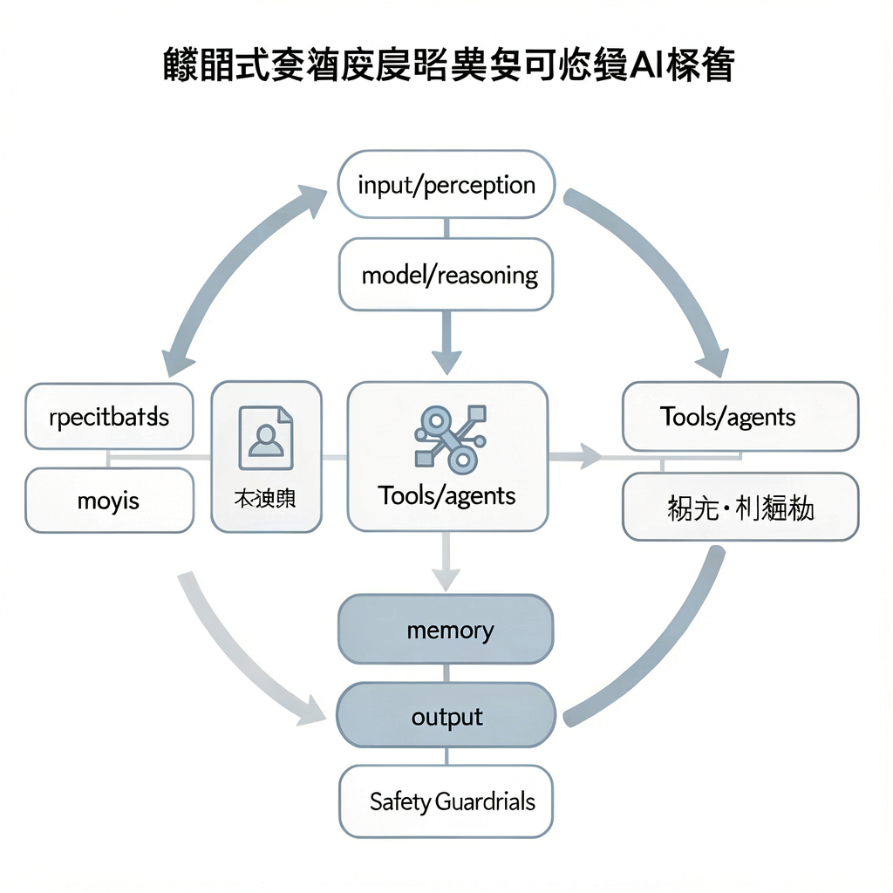

# AI 技術架構深度拆解：聯邦式混合深度學習與可解釋 AI 架構

- 日期：2026-09-12
- 選題理由：今日素材呈現三大趨勢交會：航運新聞展示衛星 5G 船舶邊緣部署需求、多篇論文聚焦聯邦學習結合 CNN-LSTM/Transformer 做隱私保護入侵偵測、黃仁勳點名 AI 資安為下一金礦。此架構同時回應海事、醫療、工業物聯網對資料主權、即時推理與合規可稽核的核心需求，具備跨域代表性。

## 一、架構原理與核心機制
【輸入/感知層】邊緣節點（船舶衛星終端、醫療閘道器、工業 PLC）蒐集多模態資料：航海 AIS/雷達/引擎感測器時序、病歷文本/影像/生理訊號、IIoT 流量封包/日誌。資料經本地前處理（歸一化、切片、特徵工程）後，僅輸出模型更新或嵌入向量，原始資料不出廠/不出船/不出院。 【模型推理層】採用混合架構：1D-CNN 擷取局部時空模式（如引擎震動頻譜、封包載荷 n-gram），LSTM/GRU 或輕量 Transformer 編碼長程時序相依（航線軌跡、病程演進、攻擊鏈）。全域模型在雲端/岸端伺服器以 FedAvg/FedProx 聚合；本地微調採用 LoRA/Adapter 降低通訊與算力負擔。推理階段支援「雲邊協同」：高風險事件（碰撞預警、敗血症預警、零日攻擊）觸發雲端大模型複核，常規判斷由邊緣小模型即時完成。 【工具/代理協作層】引入多代理編排：資料代理負責異構協定轉換（NMEA 0183、HL7 FHIR、Modbus/TCP）；訓練代理排程本地 epoch、壓縮梯度（量化/稀疏化）並處理斷線重傳；決策代理整合規則引擎（COLREGS、臨床指引、MITRE ATT&CK）與模型機率，輸出可執行動作建議。代理間透過 gRPC/NATS 通訊，支援熱插拔與版本灰度。 【記憶/資料層】三層記憶體系：(1) 短期情境記憶 — Redis/KeyDB 存放最近 N 筆推理向量與注意力權重，供 XAI 即時解釋；(2) 長期知識庫 — 向量資料庫 存放法規條文、維修手冊、威脅情報嵌入，支援 RAG 補強；(3) 聯邦元資料登記 — 區塊鏈或不可變日誌記錄每輪聚合參與節點、模型雜湊、差分隱私預算消耗，滿足審計追溯。 【輸出與監控層】輸出標準化決策物件：{event_id, risk_score, explanation_shap, recommended_action, confidence_interval, compliance_tags}。監控指標含：模型漂移、通訊延遲、隱私預算餘額、誤報/漏報率、邊緣裝置健康度。採用 Prometheus+Grafana 告警，並整合 SIEM/SOAR 進行閉環處置。

## 二、海事領域應用（含實際例子）
情境一：智慧船舶碰撞避險與航線優化。輸入資料：AIS 訊號、雷達回波、風浪感測器、引擎轉速/油耗、衛星 5G 斷續頻寬。系統運作：邊緣 CNN-LSTM 即時融合感測器預測 15 分鐘內碰撞機率；聯邦學習讓陽明船隊共享遭遇模式而不上傳航跡原始資料；XAI 以 SHAP 顯示關鍵特徵（如相對方位角變化率），船長可一鍵核准變針。價值：降低碰撞風險、省油 3-5%、滿足 IMO 數位化審計。風險：衛星鏈路延遲導致雲端複核超時、模型對罕見海況（颱風眼牆）泛化不足。 情境二：引擎室預測性維護與排放合規。輸入資料：主機缸壓、渦輪增壓器震動、燃油品質報告、NOx/SOx 連續監測儀。系統運作：聯邦訓練跨船隊故障前兆模型，本地推理輸出剩餘壽命分布；決策代理對照 MARPOL Annex VI 限值自動調整燃油噴射時序。價值：非計畫停機降低 40%、避免港國檢查缺失。風險：感測器漂移造成標籤噪聲、老舊船舶缺乏高頻採樣介面。

## 三、醫療領域應用（含實際例子）
情境一：跨院區敗血症早期預警聯邦學習。輸入資料：生命徵象時間序列、血液檢驗、給藥紀錄、醫囑文本（去識別化）。系統運作：各院區本地訓練 LSTM-Attention 模型，僅上傳梯度更新；全域模型每週聚合，下發至 ICU 邊緣伺服器即時推理；XAI 輸出前 5 大風險因子（如乳酸上升斜率、尿量下降），醫師可覆寫並回饋修正標籤。價值：預警提前 4-6 小時、假陽性率降至 15% 以下、符合個資法與 HIPAA。合規風險：模型反演攻擊洩露稀有疾病患者特徵、跨國資料傳輸需通過適足性認定。 情境二：病理切片輔助診斷與多中心品管。輸入資料：全切片影像、免疫組化染色、基因分型報告。系統運作：CNN-Transformer 混合模型在院端 GPU 叢集訓練，聯邦聚合保護影像隱私；RAG 檢索最新 WHO 分類指引輔助生成結構化報告；品管代理監控各中心診斷一致性，觸發雙盲複核。價值：診斷一致性從 88% 提升至 95%、偏遠醫院獲得專家級輔助。合規風險：醫療器材軟體分類變更需重新驗證、AI 輸出若被視為診斷依據須承擔醫療責任。

## 四、其他產業應用（含實際例子）
情境一：智慧製造產線異常檢測與知識傳承。輸入：PLC 標籤資料、視覺檢測影像、維修工單文本。系統：聯邦訓練跨廠區異常檢測模型，保護製程參數機密；代理自動將資深技師經驗轉為規則圖譜，輔助新人決策。價值：良率提升 1.2%、人才斷層緩解。 情境二：金融風控跨機構聯合建模。輸入：交易流水、徵信資料、裝置指紋。系統：水平聯邦學習結合垂直特徵對齊，XAI 滿足金管會「可解釋 AI」監管指引。價值：詐騙偵測召回率提升 18%、單一機構資料不足問題解決。風險：模型聚合時惡意參與者投毒、特徵對齊過程洩露客群重疊資訊。

## 五、限制、風險與治理建議
1. 通訊效率與異質性：衛星/5G 斷續連線導致聯邦輪次延遲、設備算力差距大（船舶邊緣盒 vs 醫院 GPU 叢集），需自適應壓縮與非同步聚合機制。2. 隱私-效能權衡：差分隱私噪聲在小樣本醫療/海事資料上嚴重損害收斂，需結合安全多方計算或同態加密，但計算開銷指數級增長。3. XAI 可靠性：SHAP/LIME 在高維時序與圖結構資料上近似誤差大，臨床/航海決策者可能過度信任或忽視解釋。4. 監管碎片化：IMO、IEC 62443、GDPR、個資法、醫療器材法規定義不同，合規成本高。5. 長尾分布與標籤稀疏：罕見海況、罕見疾病、零日攻擊樣本極少，聯邦學習難以學習全域泛化表示，需結合少樣本/持續學習策略。

## 參考來源
- https://news.google.com/rss/articles/CBMiS0FVX3lxTE9zYktXYjN5NDM5anMtTHRXbFh1NmhsV3RqTDJZRnZkQjZRTzdkWFByMjd4MzdKN0VpeGdJZS1UQmJKNTFsNm5jUmh2SQ?oc=5
- https://pubmed.ncbi.nlm.nih.gov/42686802/
- https://pubmed.ncbi.nlm.nih.gov/42769675/
- https://pubmed.ncbi.nlm.nih.gov/42745796/
- https://news.google.com/rss/articles/CBMiX0FVX3lxTE5WaDZRUEM5c0FpVmJNQTJlR3c2ckFiUWhyd2d4UmdUR3VUSTJpeDlzNkhDS3lCaUtQbDhTNUdZaHo2Sk12bmVJUXplWkdCLU5lcHNBUnB2cmlSdzM5UVpn?oc=5
- https://pubmed.ncbi.nlm.nih.gov/42721440/
