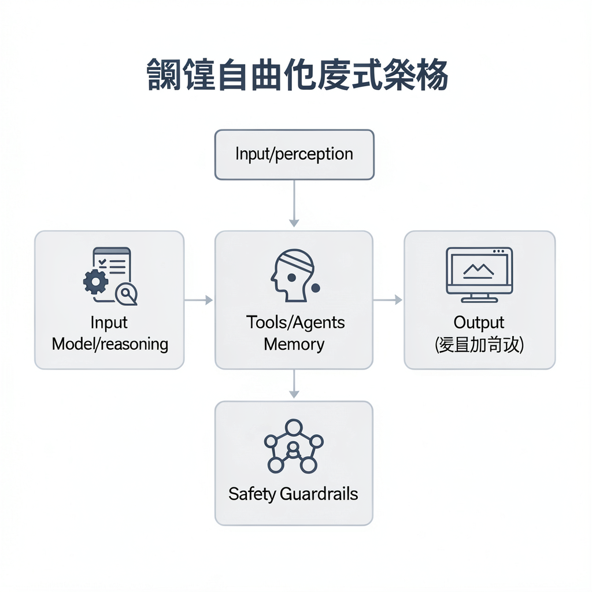

# AI 技術架構深度拆解：訓練自由代理式架構

- 日期：2026-09-19
- 選題理由：今日素材中多篇論文與產業動態同指向「無需重新訓練、即插即用的代理式系統」：LesionAgent 以零訓練實現縱向 CT 腫瘤追蹤；Sierra 估值倍增印證代理式客服商業化；具身 AI 綜述與意圖驅動論文確立理論基礎；ACCESS2 驗證自主 AI 在醫療篩檢的公平效益。此架構整合大語言模型推理、工具鏈調度、長期記憶與安全防護，為當前最具代表性的最新 AI 技術架構。

## 一、架構原理與核心機制
核心機制包含五層： 1. 輸入/感知層：接收多模態資料（影像序列、文字指令、感測器串流），經由預處理管線（去噪、配準、特徵嵌入）轉為統一語義表示。LesionAgent 以醫學影像分割模型提取病灶候選區，具身 AI 系統則融合視覺、本體感覺與環境地圖。 2. 模型推理層：採用凍結的基座大模型（LLM/VLM）作為「大腦」，透過思維鏈、ReAct 或計劃-執行-觀察迴路進行推理。關鍵在於「上下文工程」：將任務描述、工具規格、歷史軌跡、領域知識注入上下文，避免微調。 3. 工具/代理協作層：定義標準化工具介面（函數呼叫、MCP、OpenAPI），支援並行與串行調度。LesionAgent 調用測量、配準、RECIST 判讀工具；Sierra 代理串接 CRM、知識庫、票券系統；具身 AI 呼叫運動規劃、抓取、導航技能。多代理間透過訊息總線協商，支援人工介入與審核。 4. 記憶/資料層：分短期工作記憶（上下文視窗、KV Cache）、長期情節記憶（向量資料庫、圖資料庫）、程序記憶（技能庫、提示詞模板）。支援 RAG 檢索、經驗回放與持續學習，資料版本控管與存取控制符合 GDPR/HIPAA。 5. 輸出與監控層：產出結構化決策（報告、控制指令、對話回覆），並經過輸出驗證器（格式、安全、合規檢查）。可觀測性包含追蹤、指標、日誌，支援提示詞注入偵測、幻覺評分、延遲與成本監控，提供人工覆核介面與審計軌跡。

## 二、海事領域應用（含實際例子）
情境一：智慧港區調度代理。輸入：AIS 軌跡、碼頭作業狀態、氣象、潮汐、船舶載重資料。系統運作：代理接收調度指令，推理最佳泊位分配與拖輪編組，呼叫港區作業系統 API 鎖定資源，並以數位孿生模擬驗證衝突風險。價值：提升吞吐量 15-20%、減少船舶待泊時間；風險：模型對極端天氣推理失誤可能導致碰撞，需人工最後確認與責任劃分機制。 情境二：船體檢測與維護決策代理。輸入：無人機/ROV 影像、超音波測厚資料、歷史檢修紀錄、船級社規範。系統運作：視覺代理偵測腐蝕、裂紋，量測代理計算損傷嚴重度，規劃代理依據規範生成維修工單與物料清單，並追蹤執行進度。價值：將檢測週期從週縮短至日，早期發現結構風險；風險：影像雜訊導致漏檢，需雙代理交叉驗證與人工複核機制。

## 三、醫療領域應用（含實際例子）
情境一：縱向影像腫瘤追蹤代理。輸入：患者多期 CT/MRI 序列、放射科報告、RECIST/iRECIST 準則。系統運作：LesionAgent 以零訓練方式自動配準影像、分割病灶、計算長短徑、判定療效類別（CR/PR/SD/PD），生成結構化回應報告供醫師覆核。價值：減少放射科醫師 60% 量測工時，提升判讀一致性；合規風險：屬醫療器材軟體（SaMD），需 FDA 510(k)/MDR CE 認證，資料隱私須符合 HIPAA/GDPR，錯誤判讀責任歸屬須契約化。 情境二：糖尿病視網膜病變自主篩檢代理。輸入：眼底照相影像、患者病史、種族/年齡屬性。系統運作：ACCESS2 架構下的代理自動分級（無/輕度/中度/重度/增生期），對低風險出具報告，高風險自動轉介眼科醫師，並記錄決策依據供稽核。價值：縮減篩檢等待時間、改善弱勢族群就醫公平；合規風險：自主診斷屬高風險 AI，需嚴格臨床驗證、偏差測試（不同種族表現）、事後監測計畫與醫師最終簽署機制。

## 四、其他產業應用（含實際例子）
情境一：企業知識管理與客服代理。輸入：產品手冊、工單歷史、客戶對話、API 文件。系統運作：代理理解客戶意圖，檢索 RAG 知識庫，呼叫 CRM/ERP API 查詢訂單狀態、發起退貨流程，生成回覆並記錄至工單系統。價值：Sierra 案例證明可處理 70% 以上對話無需人工介入，平均處理時間縮短 40%。 情境二：工業機器人柔性製造代理。輸入：訂單 BOM、機台狀態、視覺檢測結果、刀具壽命資料。系統運作：意圖驅動代理將高階生產指令分解為運動規劃、抓取、組裝、檢測技能序列，動態調整參數應對工件公差變異，異常時觸發人工介入。價值：換線時間從小時級降至分鐘級，支援小批量多樣化生產。

## 五、限制、風險與治理建議
1. 可靠性邊界不明：凍結基座模型在分布外任務易產生幻覺與邏輯錯誤，工具調用失敗率隨鏈路長度上升。2. 安全與對抗脆弱：提示詞注入、工具濫用、記憶投毒攻擊面大，Dragos 報告顯示推理供應商難以偵測盜竊。3. 可解釋性與審計困難：多代理協作決策鏈路複雜，難以事後完整重現推理過程，監管合規受阻。4. 成本與延遲：長上下文、多輪推理、向量檢索導致 Token 成本與尾部延遲顯著，邊緣部署受限於算力與記憶體。5. 資料治理：跨系統資料存取權限、保留期限、跨境傳輸需嚴格管控，否則違反主權 AI 與隱私法規。

## 參考來源
- http://arxiv.org/abs/2611.27876v1
- https://pubmed.ncbi.nlm.nih.gov/43054956/
- https://pubmed.ncbi.nlm.nih.gov/43054954/
- https://pubmed.ncbi.nlm.nih.gov/43069285/
- https://techcrunch.com/2026/11/23/sierra-doubles-valuation-to-30b-within-six-months-as-demand-for-ai-in-cx-takes-off/
- https://www.securityweek.com/ai-inference-providers-failed-to-detect-hacking-and-prompt-theft-says-dragos/
