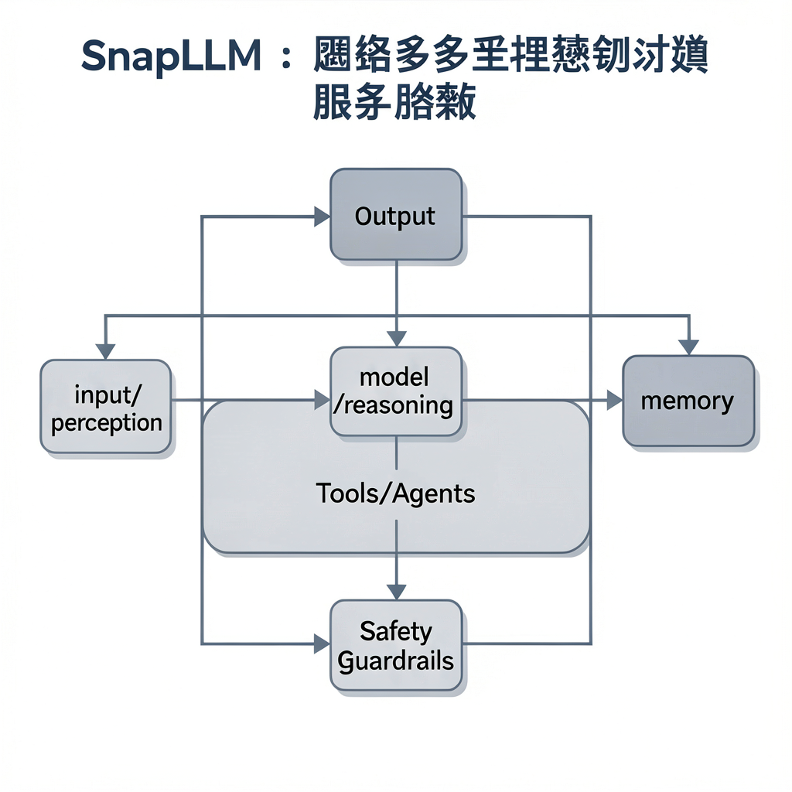

# AI 技術架構深度拆解：SnapLLM：邊緣多模型熱切換服務架構

- 日期：2026-09-26
- 選題理由：今日素材中 SnapLLM 專案（GitHub）針對邊緣裝置實現 CPU-only 20B 參數推理與亞毫秒級模型切換，結合 llama.cpp 與 stablediffusion.cpp，具體解決離線、低延遲、多模態共存的部署難題，具備跨海事、醫療、工業邊緣的普適參考價值。

## 一、架構原理與核心機制
架構分五層： 1. 輸入/感知層：統一請求總線接收 HTTP/gRPC/WebSocket，支援文本、圖像、音訊多模態輸入；前置預處理器依模型規格做 tokenizer、resize、normalization，輸出標準化張量。 2. 模型推理層：以 llama.cpp（LLM）與 stablediffusion.cpp（擴散模型）為雙引擎，透過 GGUF 量化權重（4-bit/8-bit）實現 CPU 推理；引擎封裝為無狀態 Worker，支援批次與流式輸出。 3. 工具/代理協作層：內建調度器根據請求屬性（模型 ID、優先級、記憶體佔用）動態選擇 Worker；支援 LoRA 適配器熱掛載、工具呼叫（function calling）與多輪對話上下文管理。 4. 記憶/資料層：採用分級記憶體池——VRAM/系統記憶體共享池存放熱模型權重；冷模型以 mmap 方式落盤，切換時僅需頁面調入，實現亞毫秒切換；KV Cache 以 LRU 淘汰並支援跨請求共享。 5. 輸出與監控層：統一回應格式（OpenAI 相容），內建 Prometheus 指標（延遲、吞吐、記憶體、切換耗時）、健康檢查端點與結構化日誌，支援灰度發布與熔斷。 控制流：請求→預處理→調度器→Worker 推理→後處理→回應；切換流程：調度器發送卸載信號→釋放 KV Cache→mmap 映射新權重→預熱→就緒。部署考量：單一二進制、零依賴、支援 ARM/x86、可在 Kubernetes KubeEdge 或裸金屬邊緣節點以 systemd/containerd 托管。

## 二、海事領域應用（含實際例子）
1. 船舶橋台決策輔助：輸入雷達回波、AIS 目標、ECDIS 圖層、語音指令；系統在離線邊緣伺服器同時載入航行規則 LLM（解讀 COLREGS）、視覺偵測模型（識別小型漁船）、語音轉文字模型；調度器依情境熱切換，輸出避碰建議與語音回報。價值：無衛星連線仍具備 AI 輔助；風險：模型量化可能降低小目標偵測召回率，需人工覆核。 2. 離岸風機巡檢無人機：輸入多光譜影像、飛控遙測、維護手冊 PDF；邊緣盒運行缺陷分割模型與維護知識問答 LLM，巡檢中依缺陷類型動態載入對應 LoRA 適配器，即時生成缺陷報告並同步至岸端。價值：頻寬受限環境即時結構化輸出；風險：震動環境下 CPU 熱節流導致推理延遲波動。

## 三、醫療領域應用（含實際例子）
1. 急診床邊超音波輔助：輸入超音波影像串流、病患基本資料、醫師語音紀錄；邊緣閘道器載入心臟切面分類模型、解剖標註擴散模型、病歷摘要 LLM；掃描過程中依切面自動切換模型，輸出即時標註與初步報告草稿。價值：保護隱私無需上傳雲端、離線可用；合規風險：屬醫療器材軟體（SaMD），需 FDA/CE 認證與臨床驗證，量化誤差須風險評估。 2. 社區照護藥物辨識與交互作用檢核：輸入藥袋/藥盒照片、長照機構用藥清單、護理師語音筆記；邊緣裝置運行 OCR+藥丸辨識模型、藥物交互作用知識圖譜增強 LLM；辨識完成即切換至交互作用檢核模式，輸出警示與建議劑量調整。價值：離線即時檢核降低用藥錯誤；合規風險：辨識錯誤導致漏報交互作用之醫療責任歸屬不明。

## 四、其他產業應用（含實際例子）
1. 工廠視覺檢測與知識問答一體機：生產線邊緣盒同時部署缺陷檢測模型（YOLO-GGUF）與設備維護手冊 RAG LLM；檢測到異常時自動切換至 LLM 產生處置建議，操作員以自然語言追問。價值：單一硬體支援多任務，降低邊緣硬體成本。 2. 零售智慧貨架邊緣推理：貨架邊緣裝置載入商品辨識模型、顧客行為分析模型、促銷文案生成 LLM；依時段與客流熱切換模型組合，離線完成庫存監控與個性化推播內容生成。價值：無需常駐雲端連線，回應延遲 <50ms。

## 五、限制、風險與治理建議
1. CPU-only 推理雖通用但算力上限受限於記憶體頻寬，20B 以上模型解碼速度可能 <5 token/s，不適合高吞吐場景。2. 模型熱切換依賴作業系統頁面快取，冷啟動首次推理仍有百毫秒級延遲，需預熱機制緩解。3. GGUF 量化對結構化輸出（JSON/Function Calling）準確率影響較大，需針對性評估。4. 缺乏內建分散式協同機制，多節點間模型版本一致性、負載均衡需上層編排層解決。5. 專案處於早期開發階段，文件與社群生態相對成熟方案（vLLM、Ollama）尚有差距。

## 參考來源
- https://github.com/maheshvaikri-code/snapllm
- https://www.therobotreport.com/special-report-engineering-focus-on-motion-control/
- https://www.moneydj.com/kmdj/news/newsviewer.aspx?a=7f106899-b8a7-4aca-9994-941f5128b35f
- http://arxiv.org/abs/2611.27876v1
- https://pubmed.ncbi.nlm.nih.gov/43069285/
- https://www.securityweek.com/ai-inference-providers-failed-to-detect-hacking-and-prompt-theft-says-dragos/
