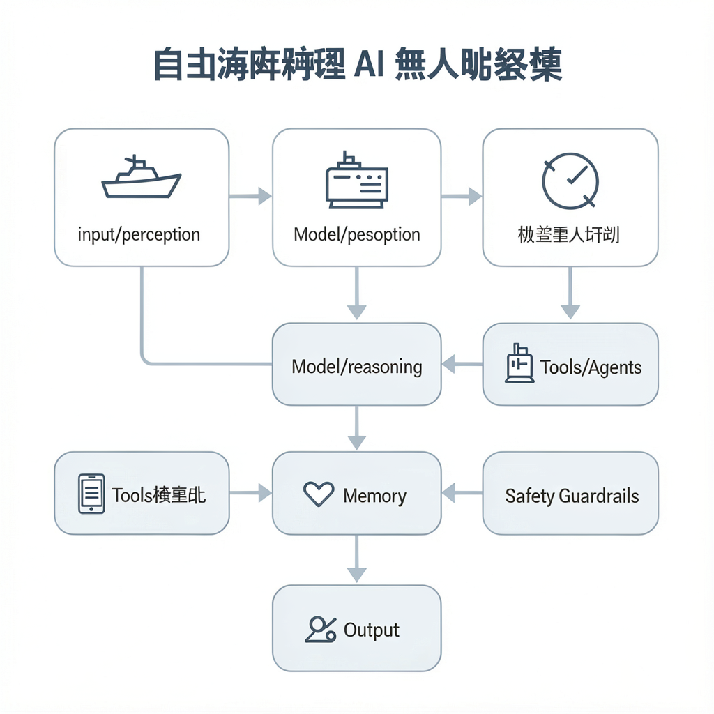

# AI 技術架構深度拆解：自主海域巡航 AI 無人船架構

- 日期：2026-10-03
- 選題理由：今日選擇自主海域巡航 AI 無人船架構，因應區域安全挑戰、提升感測融合與邊緣決策效能，並驗證國產關鍵技術自主可控，強化海洋領域意識與快速反應能力。結合多源感測器、AI 路徑規劃與自主避障，實現全天候、無人化持續巡航，降低人力風險並縮短決策迴路，支援國防與海巡雙軌任務，展現台灣海洋科技自主創新實力。

## 一、架構原理與核心機制
架構分五層： 1. 輸入/感知層：多感測器融合（雷達、激光雷達、光學相機、AIS、GNSS、慣性導航），經由邊緣推理引擎執行目標偵測、軌跡預測、海況語意分割，輸出統一環境表徵。 2. 模型推理層：包含感知網路（CNN/Transformer）、行為規劃器（基於強化學習與模型預測控制的混合規劃）、安全守則引擎（規則基礎的碰撞避免與 COLREGS 合規檢查）。推理於船上高效能 GPU/NPU 即時執行，關鍵決策延遲 <100 ms。 3. 工具/代理協作層：船載代理負責局部航行與避障；岸基艦隊管理代理透過衛星鏈路下發任務指令、接收遙測、進行全域路徑優化；雲端訓練管線定期以新資料微調感知與規劃模型並推送 OTA 更新。 4. 記憶/資料層：本地儲存高精度海圖、靜態障礙物資料庫、任務日誌、模型版本與推理快照；雲端資料湖匯總多船經驗供持續學習。 5. 輸出與監控層：向推進與舵機發送控制指令；同步遙測（位置、姿態、引擎狀態、AI 置信度）至岸端儀表板，內建異常檢測與人工介入觸發機制。

## 二、海事領域應用（含實際例子）
情境一：專屬經濟區（EEZ）巡邏。輸入：雷達/光學影像、AIS 目標、海況模型。系統即時偵測非法漁船、推斷意圖、規劃攔截航徑並自動向海巡中心回報。價值：持續無人值守、降低人員風險；風險：誤判導致外交摩擦、對抗性干擾（GPS 欺騙、雷達干擾）。 情境二：離岸風場巡檢。輸入：高解析相機、激光點雲、風機結構模型。自主導航至各風機，執行葉片裂紋檢測、螺栓鬆動判讀，生成缺陷報告。價值：減少人工登機、提高檢測頻次；風險：惡劣海況導致感測器退化、模型對未見缺陷類型泛化不足。

## 三、醫療領域應用（含實際例子）
情境一：醫院院內藥品配送機器人。輸入：激光雷達、深度相機、電梯控制介面、醫護呼叫系統。規劃器依病房佈局與即時人流動態規劃路徑，安全守則確保不阻擋急救通道。價值：釋放護理人力、縮短配送時間；合規風險：醫療器材法規（TFDA）認證、病患隱私資料不得外洩。 情境二：超音波引導穿刺輔助手臂。輸入：即時超音波影像、力覺回授、解剖標記模型。感知網路分割目標血管/器官，規劃器計算針路，安全層限制最大力與偏移。價值：提高穿刺成功率、標準化操作；風險：模型在特殊體型下漂移、需通過臨床試驗與 ISO 13485 認證。

## 四、其他產業應用（含實際例子）
情境一：智慧倉儲自動叉車編隊。輸入：貨架標籤 RFID、視覺 SLAM、WMS 任務佇列。多代理協作實現貨物搬運、動態避障與充電調度。價值：提升吞吐量 30% 以上、降低人力成本。 情境二：都市最後一哩配送機器人。輸入：高精度地圖、行人/車輛偵測、交通號誌 V2X。規劃器在人行道與車道切換，安全層遵守地方法規。價值：降低配送碳排、緩解人力短缺。

## 五、限制、風險與治理建議
感測器在濃霧、大浪、強光下性能下降，導致感知不確定性增加；衛星通訊延遲與頻寬限制遠端介入即時性；模型對罕見海況或醫療解剖變異泛化能力有待驗證；法規認證（IMO MASS、TFDA、ISO 13485）流程漫長，部署成本高；網路攻擊面廣（OTA 更新、遙控鏈路）需完善零信任架構。

## 參考來源
- https://news.google.com/rss/articles/CBMia0FVX3lxTE5Xc0pKWm56M18wb3ZtNDk2NFJBRTBYUllKMkdwZVp3akVUT21kQTU0US1ycElxT1FCQTZmUDk4SnNZUTJZdUFRWGFkZmluRWgxUnJiV0hCa0Ffb0tzX01xRXo2MEhfMkowdXU4?oc=5
- https://pubmed.ncbi.nlm.nih.gov/42284175/
- https://pubmed.ncbi.nlm.nih.gov/42118647/
- https://news.google.com/rss/articles/CBMiiwFBVV95cUxQeWtTZXY4Zjk3NWE3cGtER1lPM2ZVT3dXM3hIdzcyN21JTTBLSkZ5cDZQUy15bURxU25tWG9TX2t0QWUxU0xrZC1zVFl5RW45Y0poNUgyQTRTQTYxMGJCeXdnbmV0cnRWRDN2NlVGTkV3cnpUWUU0QjQ3RC04TWEweGNyckd6bGlKX2RR?oc=5
- https://news.google.com/rss/articles/CBMia0FVX3lxTE0yQV9jTEdkeHBGSDhmeWNWSjFvRkhZS3JOM1VWVGtmUk5ubkppdURQQm1qaXJkbjRJS09HbTZ0a1BzRGhFZ2xfQXVDM1RmenQ0cjRhcFNQTVpreExaaHZ6WTBTRWZXOU8ySkUw?oc=5
- https://github.com/XIAOJIE0519/E2E
