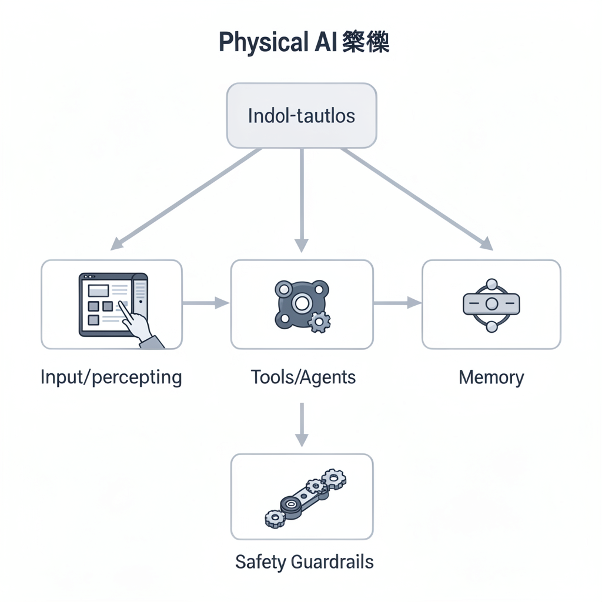

# AI 技術架構深度拆解：Physical AI 架構

- 日期：2026-10-10
- 選題理由：今日素材中 IEEE TPAMI 發表的「Aligning Perception, Reasoning, Modeling and Interaction: A Survey on Physical AI」系統性定義了具身智能的完整架構，涵蓋感知、推理、建模、交互四大核心模組與其對齊機制。此架構直接支撐海事零碳船舶自主航行、醫療 3D 影像機器人手術、邊緣 AI PC 即時推理等多個新聞熱點，且對應 PGNet 船舶偵測、MAGIC 視覺語言導航、vessel-trajectory-anomaly-detection 等專案實作，具備跨域代表性與落地驗證。

## 一、架構原理與核心機制
Physical AI 架構以「感知-推理-建模-交互」閉環為核心，強調四模組在時空維度的對齊。 1. 輸入/感知層：整合多模態感測器（LiDAR、雷達、RGB-D、IMU、SAR、醫療影像），透過時空同步與座標變換產生統一表徵。PGNet 採用 Progressive Feature Alignment 將 SAR 與光學特徵對齊；MAGIC 引入 Meta-Ability Guided Distillation 將視覺與語言指令映射至共同潛在空間。 2. 模型推理層：採用階層式架構——高層任務規劃器（LLM/VLM 基座）解析自然語言指令為子目標；中層運動/操作策略（Diffusion Policy、RL 代理）生成軌跡；低層控制器（MPC、全身控制）輸出扭矩指令。推理過程引入 Chain-of-Distillation（MAGIC）將教師模型知識蒸餾至輕量學生模型，滿足邊緣部署延遲需求。 3. 工具/代理協作：採用模組化工具鏈——感知工具（目標偵測、語意分割、軌跡預測）、規劃工具（A*、RRT*、任務圖搜尋）、模擬工具（物理引擎、數位孿生）、通訊工具（V2X、ROS 2 DDS）。代理間透過標準化介面（如 Function Calling、MCP）協作，支援多機器人編隊、船機協同、醫療多機械臂配合。 4. 記憶/資料層：分為情景記憶（向量資料庫儲存歷史任務軌跡、異常事件）、語意記憶（知識圖譜編碼領域規範、法規、操作手冊）、程序記憶（技能庫儲存可複用的運動基元）。線上學習採用 Replay Buffer + Continual Learning 避免災難性遺忘；離線優化利用數位孿生生成合成資料擴充長尾場景。 5. 輸出與監控：執行端輸出運動指令、狀態估計、風險評估報告。監控層部署運行時保證模組——安全防護罩（CBF、Hamilton-Jacobi Reachability）、異常檢測器（重建誤差、軌跡偏差）、可解釋性模組（注意力熱力圖、反事實解釋），支援人機介面即時介入與審計日誌記錄。

## 二、海事領域應用（含實際例子）
情境一：零碳智慧貨船自主航行（對應保利馬新聞與 PGNet）。輸入資料：多波束聲納、SAR 影像、AIS、氣象預報、海圖。系統運作：感知層融合 SAR/光學偵測小型船艇與漂浮物（PGNet Gaussian Geometric-Consistency）；規劃層結合天氣路由優化與 COLREGS 規則生成避碰軌跡；控制層輸出舵機/推進器指令；數位孿生同步模擬驗證。價值：降低燃油 15-20%、減少人為錯誤碰撞。風險：極端海況感知退化、法規責任歸屬未明、通訊中斷導致遠端接管失效。 情境二：港區無人駁船編隊作業。輸入資料：岸基雷達、碼頭 CCTV、V2X 訊號、駁船狀態。系統運作：中央協調代理下發編隊任務；各駁船本地代理執行分散式共識形成保持；異常檢測模組（vessel-trajectory-anomaly-detection）即時識別偏離軌跡並觸發應急制動。價值：提升吞吐量 30%、減少拖輪調度成本。風險：多代理通訊延遲抖動、惡意干擾攻擊、岸橋協同介面標準不一。

## 三、醫療領域應用（含實際例子）
情境一：AI 輔助腦腫瘤切除手術機器人（對應 2026 國產 AI 3D 醫療影像大會與 Trans-MMVAE）。輸入資料：術前 MRI/CT、術中超音波、導航追蹤器、醫師語音指令。系統運作：感知層多模態 VAE 對齊術前術中影像（Trans-MMVAE 可解釋潛在空間）；推理層生成切除邊界建議與避開功能區路徑；交互層透過力反饋手柄與語音實現共享控制；監控層即時計算殘留腫瘤體積與神經損傷風險。價值：提高全切率、縮短手術時間。合規風險：醫療器材認證（TFDA/CE/FDA）、術中資料隱私、醫師過度依賴導致技能退化。 情境二：遠端超音波診療機器人（偏鄉醫療對應松山機場新聞）。輸入資料：超音波探頭影像、機械臂力/位置、患者生命徵象、遠端專家標註。系統運作：邊緣端部署輕量分割模型（知識蒸餾自雲端大模型）即時標示解剖結構；專家遠端引導機械臂掃描；記憶層累積病例庫支援少樣本適應。價值：突破地理限制、降低轉診率。合規風險：跨機構醫療授權、網路延遲導致操作不穩、AI 診斷錯誤責任劃分。

## 四、其他產業應用（含實際例子）
情境一：工廠柔性生產線雙臂機器人組裝。輸入：3D 視覺、力覺、CAD 模型、MES 排程。系統：感知層估計工件 6D 姿態；規劃層生成無碰撞雙臂協同軌跡；技能庫調用「插銷、擰螺絲」基元；數位孿生預演優化循環時間。價值：換線時間從天縮至小時、良率提升。 情境二：AI PC 端側程式碼生成助手（對應黃仁勳新聞）。輸入：專案程式碼庫、自然語言需求、編譯錯誤訊息。系統：本地部署蒸餾後 7B Code LLM（Chain-of-Distillation）；RAG 檢索團隊最佳實踐；沙箱執行驗證生成碼；遙測收集接受率與編輯距離持續微調。價值：離線隱私保護、秒級回應、降低雲端成本。

## 五、限制、風險與治理建議
1. 現實差距：模擬訓練策略遷移至實體仍存 Domain Gap，長尾異常場景（極端天氣、罕見病理、零件公差疊加）覆蓋不足。2. 計算-能耗權衡：高階推理與多模態融合需高算力，邊緣部署（船舶、手術機器人、AI PC）受功耗、散熱、重量限制，模型壓縮易損失泛化能力。3. 安全保證缺口：運行時防護罩多基於已知模型，對分布外輸入、對抗攻擊、級聯故障缺乏形式化驗證。4. 資料治理與合規：跨域資料（航運 AIS、醫療影像、工廠感測器）擁權、去識別化、跨境傳輸法規不一，訓練資料來源合法性難審計。5. 人機信任校準：過度自動化導致操作員情境感知喪失（自動化驚愕），解釋性模組多為事後近似，難支援即時決策介入。

## 參考來源
- https://pubmed.ncbi.nlm.nih.gov/42284175/
- https://pubmed.ncbi.nlm.nih.gov/42118647/
- https://pubmed.ncbi.nlm.nih.gov/42924538/
- https://github.com/ThordurPall/vessel-trajectory-anomaly-detection
- https://github.com/jakee417/LS-SSDD-v1.0-ShipDetectionComputerVision
- https://news.google.com/rss/articles/CBMib0FVX3lxTFBkUUlxZTVBbERaOVdoeVgyYkM3SkR1OHY4Y2Z4enA0YmdmNzVsNDdaVGZiSER6UDgtRTRkYVVXX0pucDFxSmctMzRGUGJOOTBnWnFFcDQ1ODlVU05KN19UX1p0Y3NpbU1ocHk4dUlyRQ
