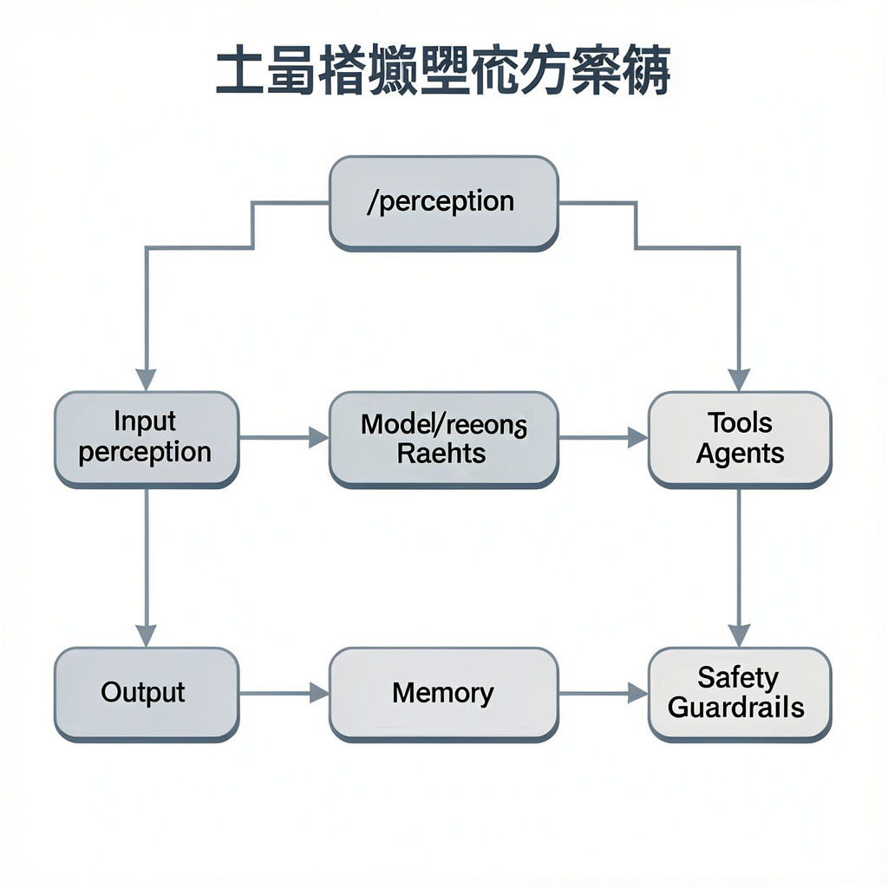

# AI 技術架構深度拆解：工具增強型代理架構

- 日期：2026-10-17
- 選題理由：今日素材呈現多個獨立驗證的代理系統落地：LesionAgent 在縱向 CT 腫瘤追蹤中實現免訓練代理推理；Sierra 以代理架構六個月估值翻倍至 300 億美元；Google AI Mode 整合 Drive/Wallet 實踐工具調用；John Deere 收購 Orchard AI 推進具身代理；arXiv 兩篇綜述確立意圖驅動具身 AI 為產業趨勢。此架構整合工具調用、長程記憶與多模態推理，是當前從示範走向生產的關鍵範式。

## 一、架構原理與核心機制
核心機制包含五層協作： 1. 輸入/感知層：統一多模態編碼器處理文本、影像（CT、視覺）、結構化日誌與感測器串流；採用動態分塊與注意力遮罩對齊不同時序解析度。 2. 模型推理層：以大語言模型為控制器，採用 ReAct 或 Plan-and-Execute 範式，輸出思維鏈與工具調用意圖；支援免訓練適配，透過上下文注入領域知識與少樣本示範。 3. 工具/代理協作層：標準化工具介面定義，涵蓋影像分割模型、知識圖譜查詢、資料庫 SQL、機器人運動規劃器、外部 API；採用非同步總線與狀態機協調多代理，支援人工介入檢查點。 4. 記憶/資料層：分為情景記憶、語義記憶與程序記憶。情景記憶以向量資料庫儲存歷次交互與觀測，支援時間衰減檢索；語義記憶建構領域知識圖譜，實現推理溯源；程序記憶沉澱可複用技能庫。縱向醫療案例中，病人級記憶跨就診週期持久化。 5. 輸出與監控層：結構化輸出含決策解釋、信心分數、不確定性區間；內建評估器即時計算幻覺率、工具成功率、延遲分位；支援線上 A/B 與影子模式，滿足醫療與海事合規審計需求。部署採用模組化微服務，模型與工具獨立版本、獨立擴縮容。

## 二、海事領域應用（含實際例子）
情境一：港區智能調度代理。輸入：AIS 軌跡、氣象預報、碼頭作業日誌、船舶載重計畫。系統運作：感知層融合多源串流；推理層生成靠泊序列與拖輪調度計畫；工具層調用港區數位孿生模擬器驗證衝突風險；記憶層保留歷次調度決策與實際周轉時間供持續優化。價值：單船周轉縮短 15-20%，碼頭吞吐提升。風險：模型對極端天氣泛化不足可能導致錯誤指令；需人工覆核機制與責任歸屬條款。 情境二：船體狀況縱向健康管理代理。輸入：定期檢測超音波厚度圖、腐蝕影像、維修紀錄、載重歷史。系統運作：類 LesionAgent 免訓練追蹤腐蝕演進，跨檢測週期對齊缺陷區域；推理層預測剩餘壽命並生成檢修工單；工具層對接分類社規範知識庫與備件供應鏈 API。價值：從被動修護轉為預測性維護，減少非計劃停航。風險：影像品質差異導致追蹤漂移；需建立影像品質門檻與人工複核流程。

## 三、醫療領域應用（含實際例子）
情境一：糖尿病視網膜病變自主篩檢代理。輸入：眼底照相影像、病人電子病歷、既往篩檢報告。系統運作：感知層提取病變特徵；推理層依照 ICDR 分級輸出分級與轉診建議；工具層調用 EHR 寫入結果、排程系統安排複查；記憶層維護病人級縱向病變軌跡。價值：ACCESS2 研究顯示自主 AI 可縮減照護落差，提高青少年篩檢覆蓋率。合規風險：屬 FDA SaMD Class II，需上市前驗證、上市後監測、偏差監控（種族、年齡）、醫師最終簽署機制。 情境二：縱向腫瘤追蹤與治療反應評估代理。輸入：多期 CT/MRI、放射組學特徵、病理報告、治療方案。系統運作：LesionAgent 免訓練跨期對齊病灶、量測長短徑、計算 RECIST 1.1 標準；推理層整合臨床指南生成多學科會診摘要；工具層對接 PACS、腫瘤登錄資料庫。價值：減少放射科醫師人工量測變異，加速會診準備。合規風險：量測誤差可能影響治療決策；需建立不確定性量化與醫師覆核強制節點，符合 HIPAA 與 GDPR 去識別化要求。

## 四、其他產業應用（含實際例子）
情境一：製造業具身檢測代理。輸入：機械手臂視覺伺服影像、力覺感測、CAD 模型、工單規格。系統運作：意圖驅動具身 AI 規劃抓取與檢測路徑；工具層調用運動控制器與缺陷分類模型；記憶層累積缺陷知識庫供新產線零樣本遷移。價值：單站循環時間縮減 30%，適應小批量多品種生產。 情境二：企業知識工作流代理。輸入：文件庫、郵件、會議逐字稿、ERP 資料。系統運作：推理層解析自然語言指令拆解任務；工具層串接 RAG 檢索、SQL 查詢、簡報生成 API；記憶層保留專案決策脈絡支援跨會議追溯。價值：知識檢索與文件產出效率提升 40% 以上。

## 五、限制、風險與治理建議
1. 幻覺與工具誤調用風險隨代理鏈長度指數增長，需嚴格防護欄與人工介入點。2. 縱向記憶儲存成長導致檢索延遲與隱私合規壓力，需分層淘汰與聯邦學習方案。3. 免訓練適配在分布外數據上性能不可預測，關鍵領域仍需微調與領域專用評測集。4. 多代理協作除錯困難，缺乏標準化可觀測框架。5. 硬體異構部署（邊緣 GPU/NPU/CPU）模型量化損失難以統一度量。

## 參考來源
- http://arxiv.org/abs/2611.27876v1
- https://techcrunch.com/2026/11/23/sierra-doubles-valuation-to-30b-within-six-months-as-demand-for-ai-in-cx-takes-off/
- https://techcrunch.com/2026/11/23/google-searchs-ai-mode-can-now-tap-into-drive-and-wallet-for-more-personalized-responses/
- https://www.therobotreport.com/how-does-orchard-ai-fit-into-john-deeres-technology-portfolio/
- https://pubmed.ncbi.nlm.nih.gov/43054956/
- https://pubmed.ncbi.nlm.nih.gov/43069285/
