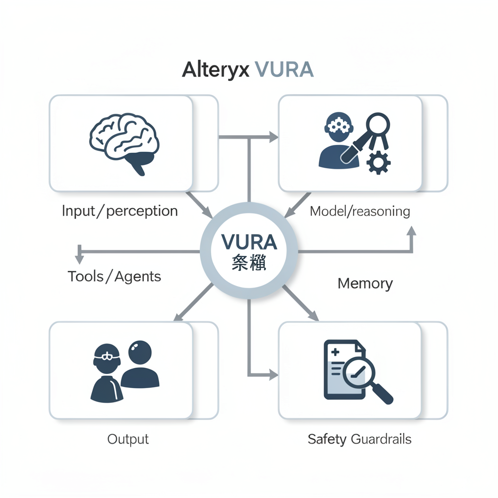

# AI 技術架構深度拆解：Alteryx VURA 架構

- 日期：2026-10-24
- 選題理由：Alteryx 發表 VURA 架構，專為企業工作流建立 AI 治理層，解決模型部署、合規、稽核與版本控制的系統性缺口，是近期少見完整描述治理層元件與資料流的公開架構。

## 一、架構原理與核心機制
VURA 架構由五大層次組成： 1. 輸入/感知層：接收使用者或排程觸發的工作流請求，包含自然語言指令、結構化參數、資料目錄查詢與策略標籤。 2. 策略與治理引擎：中央政策引擎依據模型註冊表、版本元資料、合規規則（如 GDPR、HIPAA、金融監管）即時進行存取控制、資料血緣驗證與風險評分，決定是否允許推理或需人工覆核。 3. 模型推理層：統一推理閘道負責模型載入、版本選擇、硬體加速（CPU/GPU/TPU）與批次/串流模式切換；支援多框架（ONNX、TensorRT、PyTorch）並提供推理延遲、吞吐量指標回報。 4. 工具/代理協作層：工作流編排器將推理結果串接至下游微服務（API 閘道、ETL、通知、RPA），並提供插件機制讓領域專家註冊自訂前後處理邏輯。 5. 記憶/資料層：特徵存儲、向量資料庫與審計日誌湖共同構成長期記憶，支援模型漂移偵測、資料溯源與歷史版本回滾。 6. 輸出與監控層：標準化輸出格式（JSON/Parquet/Protobuf）寫回目標系統，同時將推理指標、策略命中率、錯誤率推送至觀測平台（Prometheus/Grafana）並觸發告警與自動化回滾機制。整體控制流採事件驅動，透過訊息總線（Kafka/NATS）實現低耦合、高可觀測性的端到端治理。

## 二、海事領域應用（含實際例子）
1. 船舶航線優化工作流：輸入 AIS 軌跡、即時氣象、港口作業窗口與燃油價格；治理層驗證模型版本是否通過 IMO 碳排放合規檢核、資料血緣是否含敏感航線資訊；推理引擎輸出最低成本航線建議並回寫至航海規劃系統。價值：單航次可省 3‑5% 燃油；風險：模型漂移導致航線偏離安全水道。 2. 貨櫃碼頭自動化調度：輸入碼頭作業日誌、吊掛設備狀態、貨櫃優先級；策略引擎確保調度模型符合港口安全作業標準（ISO 28000）並記錄每次決策審計日誌；編排器將調度指令下發至 TOS（碼頭作業系統）。價值：提升吞吐量 10% 以上；風險：誤判導致吊掛碰撞或貨櫃堆疊違規。

## 三、醫療領域應用（含實際例子）
1. 影像輔助診斷管線：輸入 DICOM 影像、醫師標註與患者同意記錄；治理層檢查模型是否取得 TFDA/CE 醫療器材認證、是否完成去識別化與資料最小化；推理結果以結構化報告回寫 PACS 並記錄模型版本與推理參數。價值：縮短放射科閱片時間 30%；合規風險：若模型未通過認證或資料洩露將觸發醫療法與個資法處罰。 2. 藥物不良反應即時監測：輸入電子病歷用藥紀錄、實驗室數值、藥品不良反應資料庫；策略引擎要求模型版本具備 FDA Sentinel 計畫審查紀錄，並對每筆預警產生不可竄改審計日誌；編排器將高風險預警推送至臨床藥師工作台。價值：提前 24‑48 小時偵測潛在 ADR；風險：模型偏差造成誤報導致不必要用藥調整。

## 四、其他產業應用（含實際例子）
1. 金融風控自動化：輸入交易流水、客戶畫像、外部黑名單；治理層確保模型符合金管會「AI 模型風險管理指引」備查要求，並記錄特徵重要度與決策解釋；輸出風險分數供核心銀行系統即時封鎖可疑交易。 2. 製造預測性維護：輸入設備感測器時間序列、歷史維修工單、環境參數；策略引擎管理模型生命週期（訓練、驗證、部署、淘汰）並強制每季進行漂移測試；編排器將保養排程同步至 CMMS 系統。價值：非計畫停機時間降低 20%。

## 五、限制、風險與治理建議
治理層引入額外延遲（約 50‑200 ms），高頻即時推理場景需評估效能權衡；政策規則撰寫與維護需跨領域專家（法務、資安、領域），人力成本高；元資料品質直接影響合規判斷，若模型註冊表不完整將導致誤判；目前 VURA 緊密綁定 Alteryx 生態，移植至異構平台需二次開發；審計日誌儲存量隨工作流規模成長，需規劃長期冷熱資料分層。

## 參考來源
- https://tw.news.yahoo.com/alteryx-%E7%99%BC%E8%A1%A8-vura-%E6%9E%B6%E6%A7%8B-%E7%82%BA%E4%BC%81%E6%A5%AD%E5%B7%A5%E4%BD%9C%E6%B5%81%E6%89%93%E9%80%A0-084607241.html
- https://www.bnext.com.tw/article/93191/enterprise-ai-agent-four-operational-black-holes
- https://finance.ettoday.net/news/3277799
