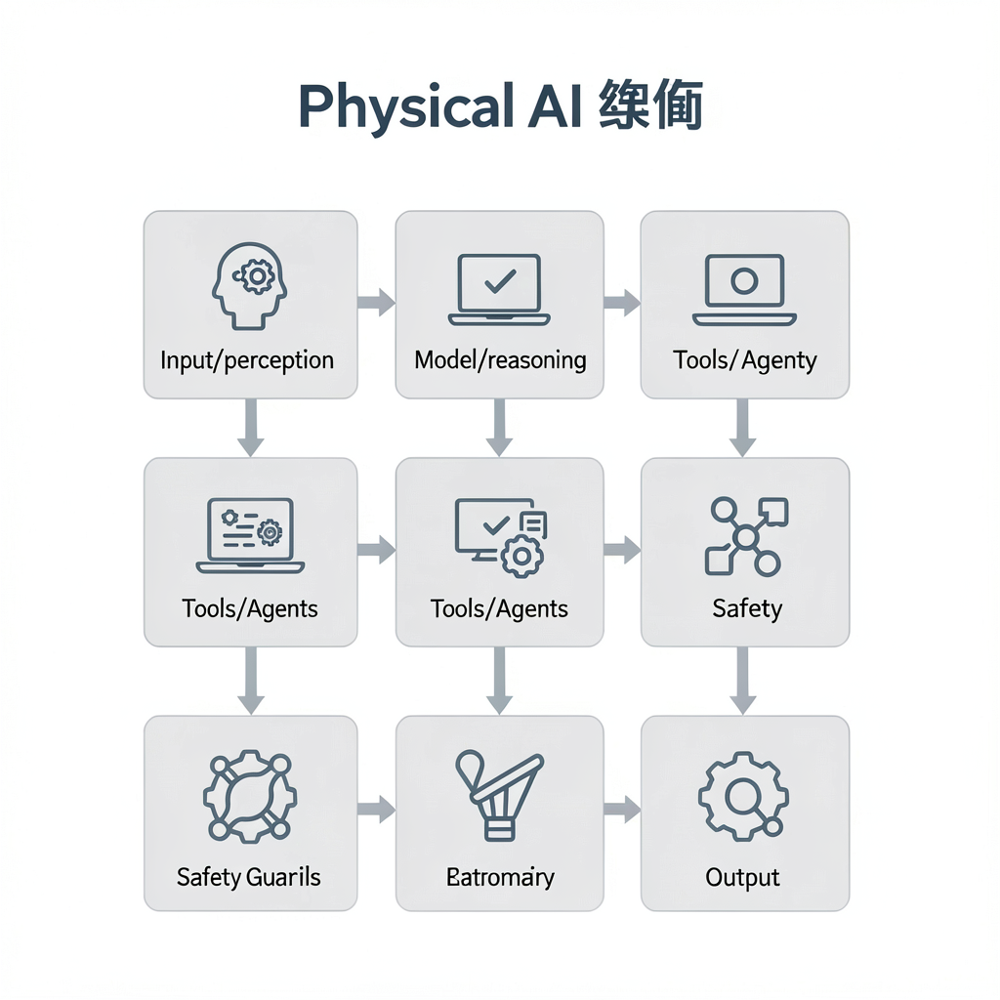

# AI 技術架構深度拆解：Physical AI 架構

- 日期：2026-10-31
- 選題理由：今日新聞報導慧友攜手 SiMa.ai 推出 Physical AI 產品布局，專注於無人機與自主系統的邊緣推理、感測融合與即時控制，代表當前將 AI 模型下沉至實體裝置的最新架構趨勢。

## 一、架構原理與核心機制
Physical AI 架構包含五大層次： 1. 輸入/感知層：整合多模態感測器（視覺相機、LiDAR、聲納、IMU、GPS/AIS），透過感測器融合演算法產生統一的環境表徵。 2. 模型推理層：採用 SiMa.ai MLSoC 等低功耗 AI 加速器，部署經量化的 CNN/Transformer 模型，支援即時目標偵測、語意分割、軌跡預測等任務，推理延遲通常在 10‑30 ms 內。 3. 工具/代理協作層：邊緣端運行任務規劃代理（如 RRT*、MPC），並透過標準化介面（ROS 2、MAVLink）調用飛控、推進、通訊等硬體抽象模組，實現感知‑決策‑執行閉環。 4. 記憶/資料層：本地環形緩衝區儲存最近數秒的感測與推理結果，供線上學習或異常回溯；關鍵事件經加密上傳至雲端資料湖，支援模型版本管理與聯邦學習。 5. 輸出與監控層：輸出控制指令至執行器，同時產生遙測資料流（位置、狀態、推理信心度）供地面站即時監控；內建安全監看門狗（心跳、異常檢測、緊急降落觸發）確保功能安全符合 ISO 26262 / DO‑178C 等標準。部署考量包括：邊緣功耗預算、散熱設計、OTA 模型更新機制、法規合規（無人機飛航許可、醫療器材認證）、供應鏈安全與模型漂移監測。

## 二、海事領域應用（含實際例子）
1. 自主巡檢無人艇：輸入多波束聲納、光學相機、AIS 訊號；邊緣推理識別管線腐蝕、漂浮物、非法漁船，規劃避障航徑並即時回傳異常影像至岸端管控中心。價值在於 24/7 無人化巡檢、降低人力風險；風險包含海況干擾導致感測退化、通訊中斷時的決策自主性不足。 2. 水下管纜監測 AUV：輸入側掃聲納、壓力感測器、慣性導航；Physical AI 於艇體內部完成即時異常偵測（斷裂、外力損傷）並自主調整航向進行細部掃描。價值為縮短故障定位時間、減少潛水員作業；風險為水下通訊頻寬極低、模型在濁水環境泛化能力待驗證。

## 三、醫療領域應用（含實際例子）
1. 手術室協作機械臂：輸入術中內視鏡影像、力覺感測、病患生理訊號；邊緣推理進行器官分割與關鍵結構追蹤，代理層協同機械臂進行精細切割與縫合輔助。價值在於提升手術精度、縮短學習曲線；合規風險涉及醫療器材軟體等級（IEC 62304）、術中資料隱私與責任歸屬。 2. 院區物流配送無人機：輸入視覺/激光 SLAM、藥品 RFID、樓層地圖；Physical AI 實現室內外無縫導航、避障與精準投遞。價值為縮短急救藥品送達時間、降低人力接觸感染風險；合規需符合民航無人機飛航規範、醫療物資追溯法規。

## 四、其他產業應用（含實際例子）
1. 智慧倉儲 AGV 叢群：多機器人共享邊緣感知地圖，透過協作代理動態分配拣貨任務，降低中央調度延遲。 2. 精準農業植保無人機：融合多光譜影像與氣象感測，邊緣推理病蟲害熱點並即時噴灑藥劑，減少藥量使用並提升作物產量。

## 五、限制、風險與治理建議
Physical AI 仍面臨邊緣算力與功耗的物理極限、模型在極端環境（強光、海霧、電磁干擾）下的泛化不足、OTA 更新過程中的版本相容與安全驗證成本高、跨域法規（民航、海事、醫療）認證流程冗長、供應鏈晶片短缺導致大規模部署風險。

## 參考來源
- https://news.google.com/rss/articles/CBMiS0FVX3lxTE5lX1BoYWhTc1JURG9iZzdQSnM3dlRJNjAwbWhMVlFYdVJYcEdZUTJMYjFDclZDVWhmX3JBUGlKUG5FcjMyTzc4MU5FNA?oc=5
- https://pubmed.ncbi.nlm.nih.gov/43082512/
- https://github.com/ThordurPall/vessel-trajectory-anomaly-detection
- https://github.com/kbhujbal/Trident-synthetic_aperture_radar_maritime_vessel_detection_yolov8
- https://news.google.com/rss/articles/CBMiWkFVX3lxTE1zUThaR1VkajZjcU9TczhFWUNHYnNpUE9xZnZYcDBIdGNkZHVzVEhycTZFcEh5UDA4X2xuc2FoeHV5RGVueFZxcTY4LTkyeEloVmJHWkNBRHJGd9IBX0FVX3lxTFB0b1VGMkxiT2RGaWZLbFRkd1ZGMVRyc0NzRl9IT0tjSUxxMlByOFNfSXladnU2aDVkTlNqQzVZby1CSmpMSUw3RF9UMGdSV1p3bUFpaVlJT1luUUs5aEl3?oc=5
- https://news.google.com/rss/articles/CBMiUEFVX3lxTFBiQW96WllEZUpLc1dCU1BUbzc1NFFramhZa2l6R1Awdm5qUUFkbG1qU2ZPanMtdTNqbDE4bzAwdldGSWhlbUhqVkpSODdrNUd5?oc=5
