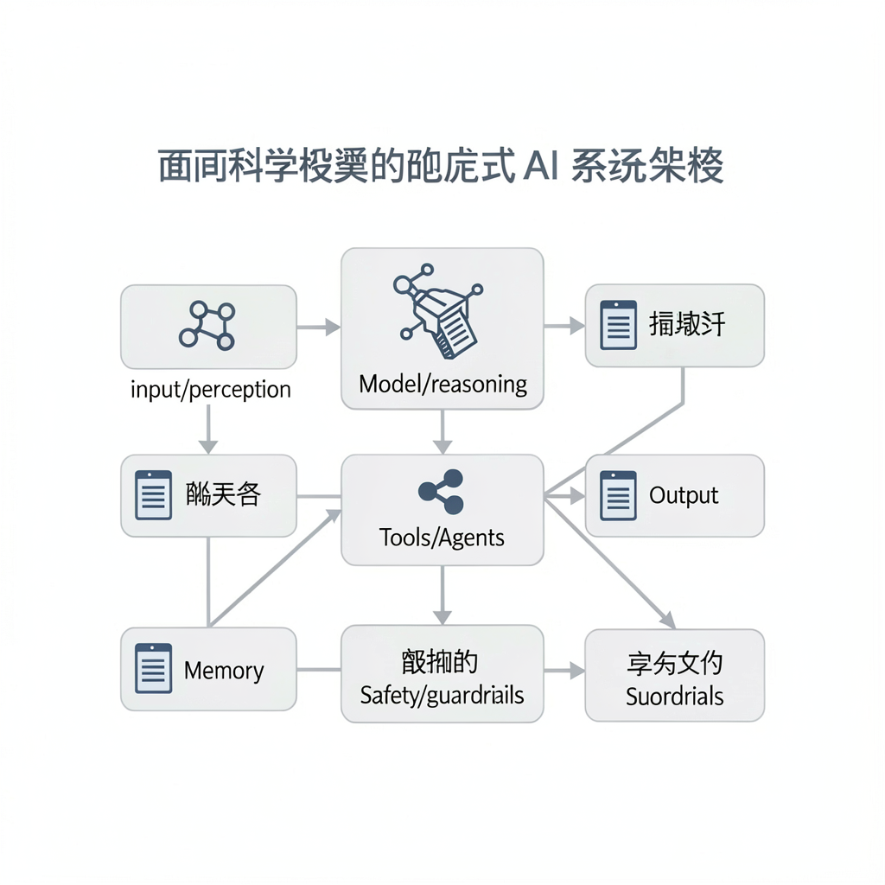

# AI 技術架構深度拆解：LesionAgent：免訓練代理式縱向醫學影像分析架構

- 日期：2026-11-07
- 選題理由：今日素材同時出現 LesionAgent 論文與開源專案，展示免訓練代理架構在縱向 CT 腫瘤追蹤的實戰能力；結合多模態基礎模型與具身 AI 趨勢，代表當前「無需微調即可部署的代理式推理」最前沿，且可延伸至海事、工業檢測等領域。

## 一、架構原理與核心機制
架構採免訓練代理設計，核心包含五層： 1. 輸入/感知層：接收縱向 CT 序列（DICOM），經預處理模組進行配準、分割、關鍵切片選擇，輸出結構化影像特徵與時間序列元資料。 2. 模型推理層：以預訓練多模態基礎模型（如 MedSAM、Rad-DINO）為骨幹，零樣本完成病灶分割、測量（RECIST 1.1）、特徵嵌入；無需針對新機構或新病灶類型微調。 3. 工具/代理協作層：LangGraph 風格有向無環圖編排多個專用工具——影像配準器、體積計算器、歷史比對器、報告生成器；代理根據任務目標動態規劃調用順序，支援人工介入檢查點。 4. 記憶/資料層：向量資料庫儲存歷次推理嵌入與結構化報告，支援跨時間點相似度檢索與趨勢分析；圖資料庫記錄病灶演變關係（新增、消失、融合、分裂）。 5. 輸出與監控層：產生結構化 JSON 報告（含體積變化率、反應評估標籤、信心分數），並推送至 PACS/RIS；內建推理追蹤、異常偵測（如測量突變）、審計日誌，支援醫療級可解釋性與合規審查。

## 二、海事領域應用（含實際例子）
1. 船殼腐蝕與裂縫縱向追蹤：輸入定期水下 ROV 影像/聲納點雲，系統自動配準多期資料，代理呼叫分割與幾何測量工具量化腐蝕深度、裂縫擴展速率，輸出維修優先級報告。價值：將人工潛水檢查頻率降低 40%，提前發現結構性風險。風險：水下能見度差導致分割誤判，需引入多模態融合（聲納+光學）與不確定性校準。 2. 港口貨櫃堆場狀態演變分析：輸入無人機定期正射影像，代理協作完成貨櫃偵測、堆高計算、周轉率估算，歷史記憶層支援異常堆疊模式預警。價值：優化堆場調度、減少貨櫃滯留。風險：遮擋與光照變化影響偵測準確度，需持續更新檢索庫。

## 三、醫療領域應用（含實際例子）
1. 腫瘤藥物治療反應縱向評估（核心場景）：輸入患者基線與追蹤 CT，代理自動完成病灶一對一配對、長短軸測量、RECIST 1.1 分類（CR/PR/SD/PD），並對比歷史嵌入判斷偽進展。價值：放射科醫師閱片時間縮短 60%，跨機構標準化一致性提升。合規風險：屬醫療器材軟體（MDSW）Class IIa/IIb，需 CE/FDA 臨床驗證、資料隱私（GDPR/HIPAA）、演算法變更管理。 2. 轉移性骨病灶負荷量化監測：輸入全身低劑量 CT 或 PET-CT，代理協作完成多病灶自動分割、總腫瘤體積計算、骨質破壞分級，記憶層支援跨期趨勢圖。價值：量化指標輔助臨床試驗終點判定。合規風險：多病灶配對錯誤率需<2%，須建立人工複核機制與責任歸屬契約。

## 四、其他產業應用（含實際例子）
1. 工業管線腐蝕/裂縫全生命週期管理：輸入定期爬管機器人影像/超音波掃描，代理輸出缺陷成長曲線與剩餘壽命預測，支援風險基礎檢查（RBI）決策。 2. 農作物長期生長表型分析：輸入衛星/無人機多光譜時序影像，代理協作完成田塊分割、長勢指數計算、病蟲害斑塊演變追蹤，輸出精準收成預測與變量施肥建議。

## 五、限制、風險與治理建議
1. 免訓練特性雖降低部署門檻，但對領域外分佈（新掃描協定、罕見病灶）泛化能力有賴基礎模型覆蓋度，極端情況仍需少樣本微調。2. 代理規劃路徑可能產生幻覺工具調用，需引入形式化驗證與人工核簽閘道。3. 縱向配準誤差會累積傳播至下游測量，需不確定性量化模組。4. 醫療/海事等高風險場景的法規認證週期長（12-24個月），開源版本不可直接臨床使用。

## 參考來源
- http://arxiv.org/abs/2611.27876v1
- https://github.com/MIC-DKFZ/LesionAgent
- https://www.moneydj.com/kmdj/news/newsviewer.aspx?a=7f106899-b8a7-4aca-9994-941f5128b35f
- https://pubmed.ncbi.nlm.nih.gov/43064800/
- https://github.com/FastCrest/tether
- https://www.securityweek.com/ai-inference-providers-failed-to-detect-hacking-and-prompt-theft-says-dragos/
