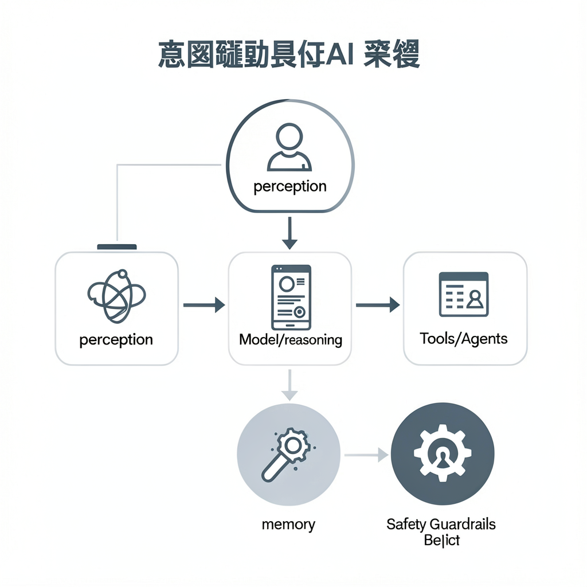

# AI 技術架構深度拆解：意圖驅動具身 AI 架構

- 日期：2026-11-14
- 選題理由：今日素材中《National Science Review》發表「Intent-driven embodied artificial intelligence」與「Survey on embodied AI for industry」兩篇論文，系統性定義以意圖理解為核心、融合多模態感知、規劃推理與實體執行的架構範式。此架構串聯海事自主航行、醫療手術機器人與工業機器人等高風險實體場景，並呼應 SailPoint 強調的 AI 代理身份治理與 MyGPT 的隱私優先 RAG 機制，具備跨域代表性與落地迫切性。

## 一、架構原理與核心機制
【輸入/感知層】整合視覺（RGB-D、雷達、聲納）、本體感覺（關節編碼器、IMU）、環境感測（溫濕度、氣體）與語言指令，經由多模態編碼器對齊至共同潛在空間，產生語義豐富的場景表徵。【意圖理解與推理層】採用大型語言模型（LLM）或視覺語言模型（VLM）解析自然語言指令，結合任務知識圖譜與情境記憶，輸出結構化意圖圖（Intent Graph），包含目標、約束、子任務序列與風險評估。【規劃與決策層】基於意圖圖，任務規劃器產生高層動作序列；運動規劃器（如 MPC、RRT*、擴散策略）將其轉換為連續軌跡；安全審核模組即時檢查碰撞、力矩限制與法規合規。【工具與代理協作層】透過標準化技能介面（Skill API）調度感知模型、檢索增強生成（RAG）知識庫、外部仿真器與其他專用代理（如導航代理、檢測代理），採用事件總線與共享黑板機制實現非同步協作。【記憶/資料層】分為情景記憶（向量資料庫儲存歷史任務軌跡與異常案例）、語義記憶（知識圖譜儲存領域規範與操作手冊）、程序記憶（技能庫儲存參數化動作基元），支援線上持續學習與離線蒸餾。【輸出與監控層】輸出低階馬達指令與高層狀態回報；監控模組包含實時異常檢測（重建誤差、分布偏移）、可解釋性日誌（意圖-動作追蹤）、人機介面覆寫通道與審計追蹤，確保可追溯與可中斷。

## 二、海事領域應用（含實際例子）
【自主港區拖輪編隊作業】情境：多艘拖輪協助大型貨輪靠離泊。輸入：多船雷達/ AIS/視覺融合感測、港管中心語音指令、海圖與潮流模型。運作：意圖層解析「安全推離碼頭」指令，生成編隊意圖圖；規劃層協同生成無碰撞軌跡，技能層調度推進器控制與纜繩作業代理；記憶層調取歷史同船型靠泊案例修正模型。價值：降低人為錯誤、縮短靠泊時間 15-20%。風險：感測器鹽霧失效導致意圖誤判、通訊延遲造成協同失步、責任歸屬模糊。【海上風機葉片自主檢測與修復】情境：無人機/爬壁機器人對葉片進行裂縫檢測與填補。輸入：高解析度視覺/熱紅外/超音波掃描、葉片數位孿生模型、維護手冊。運作：感知層定位缺陷座標；意圖層解析「依 ISO 標准完成修復」；規劃層規劃機械臂路徑避開雷擊受損區；技能層執行打磨、塗膠、固化流程；監控層即時比對固化溫度曲線。價值：減少人員高空作業風險、提升檢測覆蓋率至 95% 以上。風險：海上風場強風干擾運動規劃、通訊中斷導致任務中止無法安全復歸、修復品質驗收標準尚未法制化。

## 三、醫療領域應用（含實際例子）
【腹腔鏡手術輔助機器人】情境：醫師透過自然語言與手勢指揮機械臂進行縫合。輸入：內視鏡 4K/3D 影像、機械臂關節狀態、醫師語音/眼動追蹤、術前 CT 重建。運作：意圖層解析「以 3-0 可吸收線完成連續縫合，間距 5mm」；規劃層生成針路軌跡避開血管；技能層調度「持針」、「穿刺」、「打結」技能基元；RAG 層檢索該手術階段出血處理指南；監控層即時計算組織受力並預警過度牽拉。價值：提升縫合一致性、縮短學習曲線。合規風險：FDA/ TFDA 視為 Class II/III 醫療器材需臨床試驗、術中 AI 決策錯誤責任歸屬（醫師 vs 廠商）、患者隱私資料跨境訓練合規。【康復外骨骼步態訓練系統】情境：中風患者穿戴外骨骼進行地面行走訓練。輸入：IMU/壓力鞋墊/肌電訊號、治療師設定訓練目標（速度、對稱性）、患者病歷。運作：意圖層生成「適應性輔助」意圖；規劃層依即時步態相位調整關節阻抗參數；記憶層記錄每次訓練動力學數據供長期追蹤；監控層偵測跌倒前兆並觸發急停。價值：個性化訓練強度、量化康復進度。合規風險：醫療器材軟體生命週期管理（IEC 62304）、患者生理數據屬特殊個資需 GDPR/個資法加密、演算法更新需變更許可。

## 四、其他產業應用（含實際例子）
【半導體晶圓廠自主物料搬運系統（AMHS）】情境：百萬片晶圓/月產能下的無人搬運。輸入：調度系統指令（SECS/GEM）、車隊即時定位（LiDAR/UWB）、路徑拓撲圖。運作：意圖層將「優先處理 Hot Lot」轉換為多車協同意圖；規劃層解決多車衝突與動態避障；技能層調度載具上下料、電梯呼叫代理；記憶層沉澱尖峰時段最優調度策略。價值：提升吞吐率 8-10%、減少人力成本。【化工廠巡檢與洩漏應變機器人】情境：定期巡檢與緊急氣體洩漏偵測。輸入：四足機器人多模態感測（光學氣體成像、熱像、聲音）、廠區 3D 地圖、應變 SOP 文件。運作：意圖層解析「執行每日巡檢」或「確認洩漏源並關閥」；規劃層生成覆蓋路徑或最短介入路徑；技能層執行閥門操作、氣體採樣；RAG 檢索化學品 MSDS 指導防護等級。價值：降低人員進入高風險區頻率、縮短應變時間。

## 五、限制、風險與治理建議
1. 意圖解析在模糊、多義或跨語言指令下仍易產生幻覺，導致下游規劃錯誤。2. 真實世界長尾分布（極端天氣、罕見缺陷、突發病理）難以在訓練覆蓋，仿真到實機差距仍大。3. 多代理協作通訊延遲、頻寬限制與單點故障擴散風險高，需設計降級機制。4. 持續學習面臨災難性遺忘與資料隱私（醫療/國防）雙重約束，聯邦學習通訊開銷大。5. 法規與責任框架滯後：具身 AI 決策鏈長，難以界定「人在回路」邊界，保險與認證標準尚未成熟。6. 算力與能耗邊緣部署受限，大模型蒸餾後推理精度下降需權衡。

## 參考來源
- https://pubmed.ncbi.nlm.nih.gov/43054956/
- https://pubmed.ncbi.nlm.nih.gov/43054954/
- https://pubmed.ncbi.nlm.nih.gov/43073267/
- https://news.google.com/rss/articles/CBMiZ0FVX3lxTE5BcGRVVTExbVF1NTk4eC1oQVNIWmZyWUdTR2ljS29PWXlYb240ZGw1RmJObVIxdnpyUzFPZVlOV3VVZ1JTWnI5RkxHWXk0QmlYZ09EUnVoZGhJQ1RIOFYxMENnUmd5VUE
- https://news.google.com/rss/articles/CBMiUkFVX3lxTFB3QWt0VEFuUW9LYW1zOTdsVTVGeFBUQ1RLWktIeFZXS2w4OVFsbmNrMi1SNFk5b1B3RkMzVXhmSmlGcGN0YmdGOHNxWTFPZzFFZkE
