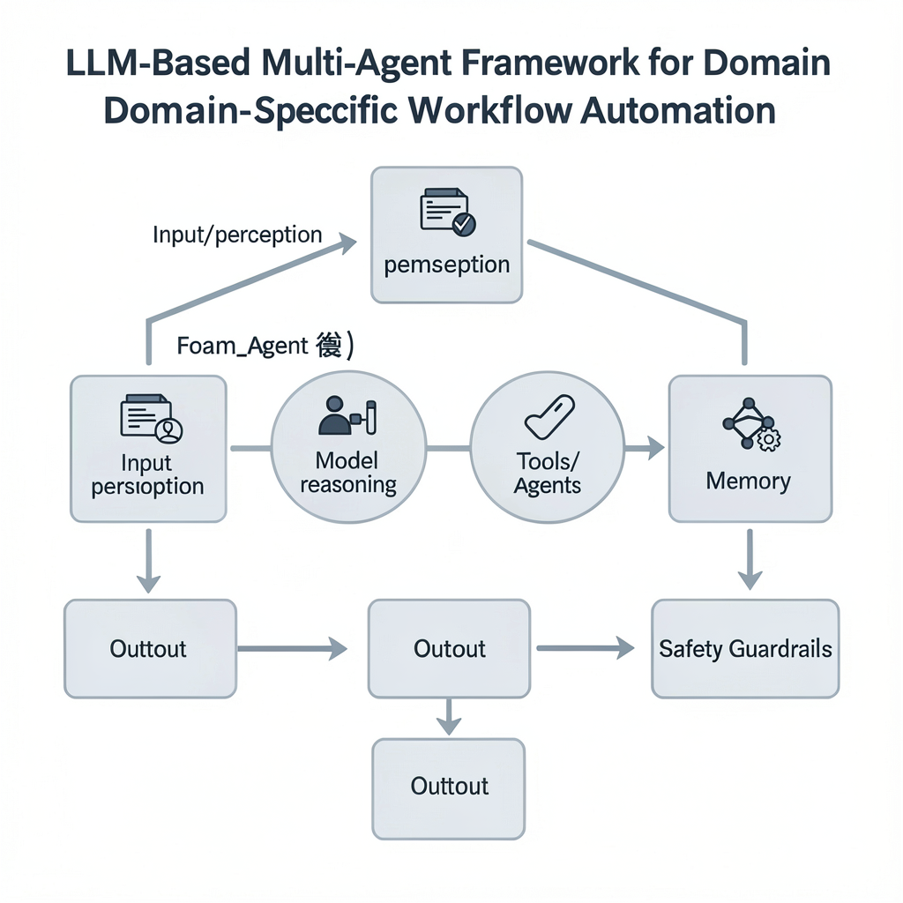

# AI 技術架構深度拆解：LLM-based Multi-Agent Framework for Domain-Specific Workflow Automation (以 Foam-Agent 為代表)

- 日期：2026-11-21
- 選題理由：今日素材呈現三大趨勢交會：Foam-Agent 專案實證多代理 LLM 自動化 CFD 流程；Nature 發表「Intent-driven embodied AI」與工業具身 AI 綜述，強調意圖驅動、工具鏈與環境回饋；醫療影像新聞顯示領域專用 AI 從被動分析轉向主動決策。此架構代表 AI 從通用聊天轉向「自主執行專業工程/科學工作流」的關鍵範式，具備跨海事、醫療、製造的可複製性。

## 一、架構原理與核心機制
【輸入/感知層】接收非結構化指令（自然語言任務描述）、結構化工程參數（幾何模型、邊界條件、材料屬性）、即時感測器資料流（壓力場、溫度場、影像序列）。透過領域特定編碼器（如 CFD 前處理器、DICOM 解析器）將異構資料投影至統一語義空間。 【模型推理層】採用「規劃-執行-觀察-反思」迴路：Planner LLM 依領域知識圖譜分解高層目標為原子子任務（網格生成、求解器設定、後處理）；Executor 代理調用專用工具（OpenFOAM、ANSYS、PyTorch 推理引擎）；Critic 代理以物理約束（質量守恆、邊界條件滿足度）與歷史案例庫評分輸出品質。 【工具/代理協作層】採用訊息總線（如 LangGraph、AutoGen）實現代理間非同步通訊：Domain Agent 擁有專用工具集（網格生成器、湍流模型選擇器）；Data Agent 管理版本化資料集與中間產物；Orchestrator 依拓撲排序調度並處理失敗重試與人工介入检查點。 【記憶/資料層】分三級：情景記憶（向量資料庫存儲過往案例、失敗模式、最佳實踐）；語義記憶（知識圖譜編碼物理定律、法規標準、設備規格）；程序記憶（可執行工作流模板與參數化腳本）。支援 RAG 檢索增強推理與線上微調。 【輸出與監控層】產出可驗證成果物：模擬報告、優化參數集、合規檢核清單。內建可觀測性堆疊：執行追蹤、Token 成本、物理一致性指標、審計日誌；支援人機回環確認與自動化 CI/CD 部署至邊緣推理節點。

## 二、海事領域應用（含實際例子）
【船體阻力優化 CFD 自動化】情境：造船廠需在數週內完成 50+ 船型阻力預測。輸入：船體 IGES/STEP 檔、設計吃水、服務速度、湍流模型偏好。系統運作：Planner 分解為幾何清理→封閉水域網格生成→邊界層網格加密→求解器設定（k-ω SST/IDDES）→後處理阻力分解；Critic 以 ITTC 不確定度準則自動驗證網格收斂與殘差。價值：將單案周期從 3 天壓縮至 4 小時，工程師僅審核異常案例。風險：極端船型（如 LNG 艙、雙體船）可能缺乏訓練案例導致網格策略失效，需人工介入。 【港口拖輪調度與航道維護決策】情境：大型港口日調度 200+ 艘次，需即時應對風浪、潮汐、突發故障。輸入：AIS 軌跡、氣象預報、拖輪狀態、航道水深偵測點雲。系統運作：多代理協作——預測代理輸出 6 小時流場場景；優化代理以強化學習+LLM 约束求解拖輪分配與航速剖面；合規代理檢核 IMO/港規。價值：降低等待時間 15%、燃油 8%。風險：極端天氣下模型外推不可靠，需硬性安全閘門覆寫。

## 三、醫療領域應用（含實際例子）
【醫療影像診斷流程自動化】情境：放射科日處理 200+ CT/MRI，需標註腫瘤、器官分割、RECIST 量測。輸入：DICOM 影像序列、臨床病歷文字、既往報告。系統運作：分割代理呼叫 nnU-Net/SAM-Med3D 產生 3D 掩膜；量測代理計算長軸/短軸、體積倍增時間；報告代理依結構化模板生成初稿；審核代理以一致性規則（如淋巴結短軸>10mm）標記異常。價值：報告撰寫時間縮減 60%，漏診率下降。合規風險：屬醫療器材軟體（SaMD），需 FDA 510(k)/MDR CE 認證；資料隱私須符合 HIPAA/GDPR，模型漂移需定期臨床驗證。 【臨床試驗方案設計與患者匹配】情境：製藥廠設計 III 期試驗，需優化納排標準並快速篩選受試者。輸入：協議草案、真實世界資料（EHR、基因體、影像）、歷史試驗統計。系統運作：資格代理以 NLP 解析納排條件轉為可執行查詢；模擬代理以合成控制臂預測入組率與統計功效；安全性代理交叉檢核藥物交互作用與禁忌症。價值：方案設計週期從 6 個月縮至 8 週，入組效率提升 30%。合規風險：合成控制臂接受度因監管機構而異；患者資料去識別化與再識別風險需嚴格治理。

## 四、其他產業應用（含實際例子）
【半導體製程參數優化】晶圓廠需在新製程量產前優化 200+ 製程參數（蝕刻、薄膜、光刻）。輸入：設備感測器時序資料、量測光譜、缺陷檢測圖。系統：代理協作執行虛擬 DOE、物理導向神經網絡代理模型加速、約束滿足搜尋。價值：研發試片輪數減少 40%，良率提升 2-3%。 【電力系統即時安穩度防禦】輸電營運商需在亞秒級判斷 N-1/N-2 故障後續措施。輸入：PMU 相量資料、拓撲變更、負載預測。系統：感知代理異常檢測→決策代理生成切負載/發電機調度方案→驗證代理時域模擬驗證。價值：防禦動作啟動時間從秒級降至 200ms 內。

## 五、限制、風險與治理建議
1. 幻覺與物理不一致：LLM 可能生成違反守恆定律的參數，需硬性物理約束層與 Critic 代理雙重把關。2. 長鏈推理脆弱性：多步驟工作流中單一代理錯誤會級聯放大，需冪等設計與檢查點回滾機制。3. 領域知識獲取成本高：知識圖譜建構依賴專家訪談與文獻萃取，難以快速遷移至新子領域。4. 算力與延遲權衡：完整多代理迴路單次執行可能耗費 10^5-10^6 tokens，邊緣部署需模型蒸餾與工具鏈精簡。5. 責任歸屬模糊：自主決策導致事故時，法律責任歸屬（開發者、部署者、使用者）尚無共識。

## 參考來源
- https://github.com/csml-rpi/Foam-Agent
- https://pubmed.ncbi.nlm.nih.gov/43054956/
- https://pubmed.ncbi.nlm.nih.gov/43054954/
- https://news.google.com/rss/articles/CBMiWkFVX3lxTFBNUTZTVndTZGRod1M4Y1NMTW14RXdfaldpd2haODVteTNWaXFwZHBSQm1vYXU2Q1pEOUVuQ2tEUFY0TWhGVEMyd0R2a2RlT0w5aU1RZGZMM2YzZw
- https://news.google.com/rss/articles/CBMiS0FVX3lxTE5DYVR3TkNYYkxjMlhVNW5BZlJpaUc5QjFXN2ViYWMtdDUxTE9XZzV6aEVuM3Jjek5KSThSNjNDSlBfSmlqZEhuZnhiMA
- https://github.com/maheshvaikri-code/snapllm
