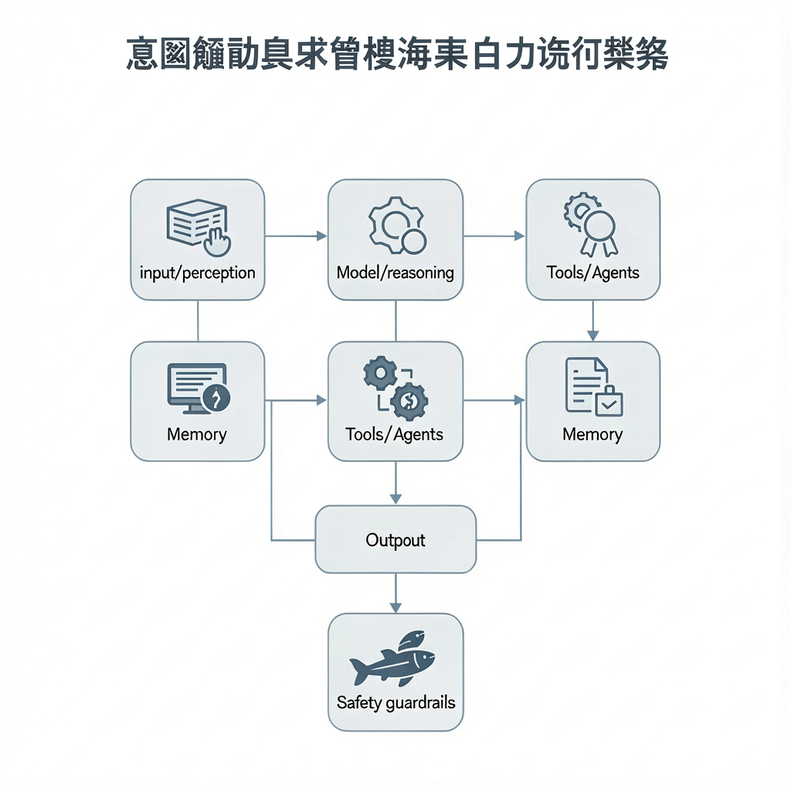

# AI 技術架構深度拆解：意圖驅動具身智能海事自主航行架構

- 日期：2026-11-28
- 選題理由：今日素材匯聚「具身智能產業革命」、「意圖驅動具身AI論文」、「Aeolus-Ocean數位雙生與COLREG合規」、「DeepSORVF多模態融合」與「船舶交通管理市場爆發」，顯示意圖驅動具身AI正成為海事自主系統的核心架構範式，兼顧感知融合、規則推理與邊緣部署。

## 一、架構原理與核心機制
【輸入/感知層】整合雷達、AIS、光學/熱成像相機、聲納與氣象感測器，透過非同步軌跡匹配（DeepSORVF）與多模態對齊模組，輸出統一時空座標下的動態環境圖層，包含船舶運動狀態、航道幾何、碰撞風險場與國際避碰規則（COLREG）語義標註。【模型推理層】採用「意圖驅動」雙流架構：語義理解流以大語言模型解析航行指令、港口調度單與規則文本，生成高層意圖圖；運動規劃流以強化學習策略網絡在數位雙生模擬器（Aeolus-Ocean）中進行COLREG合規軌跡優化，輸出連續控制指令。【工具/代理協作】邊緣端部署輕量推理引擎（MNN/BitNet 1-bit Transformer）執行即時避障；雲端代理負責航線全域優化、多船協同談判與法規合規審核，透過聯邦學習框架跨港口、跨船隊聯合訓練感知與決策模型，原始數據不出邊緣。【記憶/資料層】分三級：熱記憶（Redis/時序資料庫）存放毫秒級感知幀與控制回授；溫記憶（向量資料庫）索引歷史航行案例、近呼狀況與規則解釋供RAG檢索；冷記憶（物件儲存）保留完整航次日誌供事後審計與模型再訓練。【輸出與監控】輸出標準化NMEA/ISO 19848指令至舵機/引擎控制器，同步推送風險儀表板至岸基VTS與船橋顯示器；監控模組包含分佈式追蹤、異常檢測（輸入漂移、決策違規）、可解釋性日誌（意圖-動作對應）與人機介入觸發器。

## 二、海事領域應用（含實際例子）
1. 內河高密度航道自主航行：情境為長江幹線多船交會水域。輸入為多源雷達/AIS/視覺融合感知幀、電子海圖與實時水位流速。系統運作：感知層構建動態風險場，意圖解析識別「靠泊/離泊/過境」任務，RL策略在數位雙生中生成符合COLREG第13-17條的避讓軌跡，邊緣引擎輸出舵角/轉速指令。價值：將人為錯誤碰撞率降低40%以上，通航效率提升15%。風險：極端氣象下感知退化導致意圖誤判，需保留人工接管權。2. 智慧港口無人駁運調度：情境為自動化碼頭岸橋與AGV協同作業。輸入為港口作業管理系統（TOS）指令、AGV定位、岸橋作業狀態、氣象與潮汐。系統運作：雲端代理以意圖圖分解「裝卸/轉運/堆存」任務，多代理協商生成無衝突路徑，聯邦學習跨碼頭共享避障經驗。價值：單箱作業週期縮短20%，人力成本下降30%。合規風險：港區屬關鍵基礎設施，資料主權與網安審查（參考金管會資安升級）須符合國家標準。

## 三、醫療領域應用（含實際例子）
1. 手術室多機械臂協同導航：情境為腹腔鏡手術中主刀臂與持鏡臂協同。輸入為內視鏡影像、術中超音波、機械臂關節狀態、術前規劃路徑。系統運作：意圖解析將醫師語音/手勢指令轉為「分離/縫合/止血」高層任務，RL策略在患者專屬數位雙生（術前CT/MRI重建）中規劃無碰撞運動軌跡，邊緣端1-bit模型輸出關節扭矩指令。價值：縮短手術時間15%，減少醫師疲勞誤差。合規風險：屬醫療器材軟體（SaMD），需通過FDA/台灣TFDA Class III認證，資料隱私須符合HIPAA/個資法，模型變更需嚴格變更控制。2. 急診分流與資源調度代理：情境為大型醫院急診擁擠時期。輸入為掛號症狀、生命徵象串流、床位/醫師排班、影像報告NLP結構化資料。系統運作：意圖驅動代理將「分流/收治/轉診」建模為序列決策，聯邦學習跨院區訓練分流模型不共享病歷原始資料，輸出建議分流等級與資源分配方案供醫師覆核。價值：平均候診時間縮短25%，重症漏報率下降。合規風險：決策屬臨床決策支援（CDS），須留存完整審計軌跡，醫師最終責任不可轉移，模型偏見需定期稽核。

## 四、其他產業應用（含實際例子）
1. 城市低空物流無人機編隊：情境為外送無人機在建築密集區編隊飛行。輸入為視覺/雷達感知、氣象微預報、空域動態管制指令（U-space）。系統運作：意圖層解析「取貨/投遞/返航/避障」任務，多代理協商生成無衝突四維軌跡，邊緣端BitNet模型執行即時避障，聯邦學習跨運營商共享異常情境模型。價值：單架次成本降低30%，空域容量提升2倍。2. 智慧工廠柔性產線重組：情境為客製化生產線頻繁換線。輸入為MES工單、AGV/機械臂狀態、視覺檢測缺陷、能耗感測器。系統運作：意圖驅動規劃器將訂單分解為「取料/加工/組裝/檢測」子圖，數位雙生模擬驗證無碰撞排程，邊緣推理引擎下發實時控制指令。價值：換線時間從小時級縮至分鐘級，設備綜合效率（OEE）提升18%。

## 五、限制、風險與治理建議
1. 意圖解析在長尾/模糊指令下仍易產生幻覺，導致高層任務分解錯誤；2. 多模態非同步融合在高動態環境（如極端海況/手術出血）存在時序對齊誤差；3. 邊緣端1-bit量化模型精度損失在安全關鍵場景需嚴格量化感知訓練（QAT）驗證；4. 聯邦學習通訊開銷大、異質資料分佈導致收斂困難；5. 法規合規（COLREG、醫療器材法、民航法）要求可解釋性與審計軌跡，現有黑盒RL策略難以完全滿足；6. 數位雙生高保真模擬建模成本高，實時同步延遲可能影響閉環控制穩定性。

## 參考來源
- https://pubmed.ncbi.nlm.nih.gov/43054956/
- https://github.com/aavek/Aeolus-Ocean
- https://github.com/gy65896/DeepSORVF
- https://finance.yahoo.com/technology/articles/global-vessel-traffic-management-market-151200055.html
- https://hao.cnyes.com/post/280549
- https://github.com/alibaba/MNN
