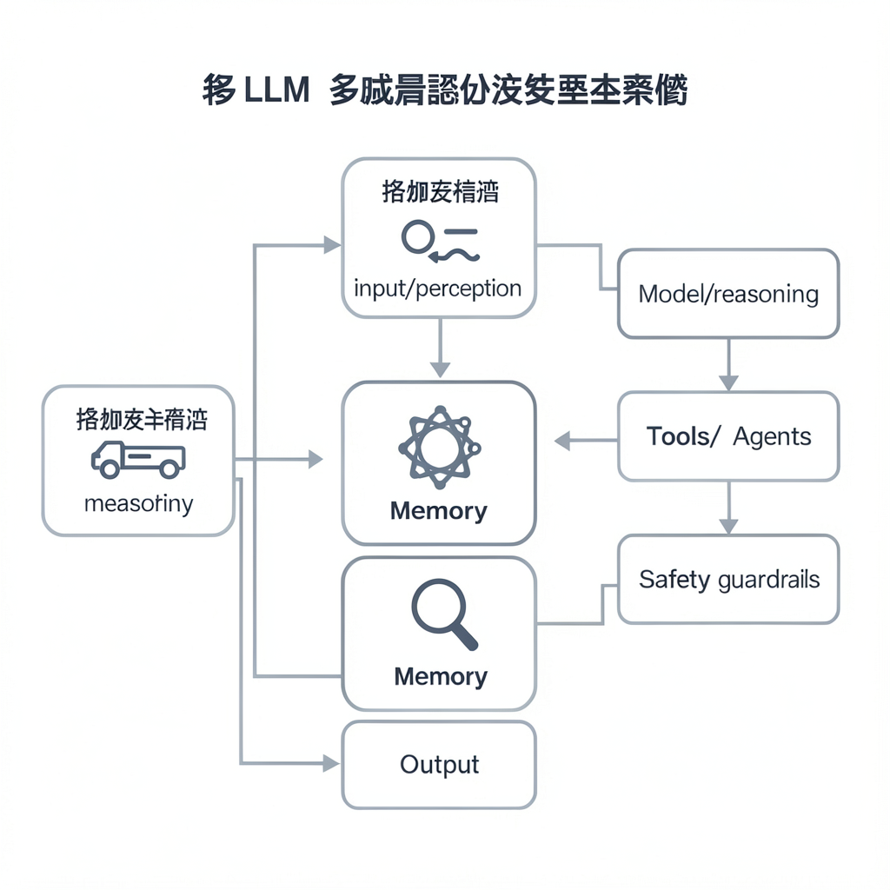

# AI 技術架構深度拆解：多 LLM 多代理認知反思平衡架構

- 日期：2026-09-13
- 選題理由：因應AI經濟加速與單一模型風險，多LLM多代理認知反思平衡架構能整合異質智慧、強化可解釋性與道德對齊，降低單點失誤，提升醫療、資安等高風險領域的決策可靠度，符合具身智慧與隱私保護趨勢。

## 一、架構原理與核心機制
架構包含五大層： 1. 輸入/感知層：接收自然語言查詢、結構化資料（如法規、病歷、船舶日誌），經由統一的語義編碼器轉為向量表示，並標註來源與信任度。 2. 模型推理層：部署多個專用 LLM（如法律、醫療、航海領域微調模型），各自獨立生成初步回答與信心分數。 3. 工具/代理協作層：引入協調代理，依據認知反思平衡演算法，讓各 LLM 互相批判、補充，並呼叫外部工具（知識圖譜查詢、模擬引擎、法規檢索）以修正推理鏈。 4. 記憶/資料層：採用分層記憶體——短期對話緩存、長期向量資料庫（含領域知識、歷史決策）、以及可審計的決策日誌，支援增量學習與回溯。 5. 輸出與監控層：彙整協調代理產出的最終建議、解釋路徑、不確定性量化，並透過監控模組即時記錄推理軌跡、偏差指標與合規檢查，供人工覆核與自動化治理使用。

## 二、海事領域應用（含實際例子）
案例一：港口船舶調度決策支援。輸入：即時 AIS 軌跡、天氣預報、港口作業規則、貨物優先級。系統運作：感知層編碼多源資料；推理層由航海 LLM 生成初步調度方案；協作層引入氣象代理與法規代理交叉驗證，呼叫模擬引擎評估擁塞風險；記憶層提供歷史調度績效作為參考；輸出層給出調度順序、風險等級與解釋。價值：提升吞吐量、降低碰撞風險。風險：模型對極端天氣的泛化能力不足，可能產生誤導性建議。 案例二：船舶機艙故障診斷與維修規劃。輸入：感測器串流、維修手冊、過往故障紀錄。運作類似，協作層加入設備知識圖譜代理，輸出故障定位、備件需求與作業步驟。價值：縮短停機時間。風險：感測器噪聲導致誤判，需人工二次確認。

## 三、醫療領域應用（含實際例子）
案例一：多學科會診輔助。輸入：病歷文字、影像報告、基因檢測、臨床指引。系統：感知層統一編碼；推理層由內科、腫瘤科、放射科 LLM 分別給出診斷建議；協作層透過認知反思平衡讓各專科代理互相質疑、補充，並呼叫指引檢索工具；記憶層提供同質病例歷史；輸出層產出綜合診斷報告、治療選項與證據鏈。價值：縮短會診時間、提升決策一致性。合規風險：醫療決策最終須由醫師簽署，系統僅供參考，若輸出錯誤可能涉及醫療責任。 案例二：藥物交互作用即時檢核。輸入：處方清單、患者用藥史、藥物資料庫。運作：推理層由藥理 LLM 生成交互風險；協作層引入法規代理確認處方合規；記憶層記錄過往不良反應；輸出層標示高風險組合與替代建議。價值：降低用藥錯誤。合規風險：資料隱私需符合 HIPAA/個資法，模型更新需經臨床驗證。

## 四、其他產業應用（含實際例子）
案例一：企業 ESG 報告自動生成。輸入：財務報表、碳排放數據、供應鏈審計紀錄。系統由財務、環境、治理三 LLM 協作，輸出符合 GRI/TCFD 標準的報告草稿與解釋。價值：減少人工編寫成本。案例二：智慧客服多輪對話管理。輸入：用戶對話歷程、產品知識庫、政策文件。協作層讓意圖識別、知識檢索、合規審核三代理並行，輸出回覆與升級建議。價值：提升首聯解決率。

## 五、限制、風險與治理建議
1. 多 LLM 協作延遲較高，即時性要求嚴格場景需優化推理管線。2. 認知反思平衡演算法依賴人工設計的批判規則，難以覆蓋所有領域邊界情況。3. 記憶層資料品質直接影響輸出可信度，需持續治理。4. 可解釋性雖有軌跡記錄，但深層神經網路內部機制仍屬黑箱，監管審計仍具挑戰。5. 部署需跨雲端/邊緣異構環境，模型版本一致性與資料同步增加運維複雜度。

## 參考來源
- https://pubmed.ncbi.nlm.nih.gov/42783572/
- https://news.google.com/rss/articles/CBMimgJBVV95cUxPbU0zdHQ2N3NvR1FiR0ptSGxmdDE5MmZEdEtrMDY0M1F1OHhFYlNFWFNyaVNYb2ZkbWJZSlE4Sko4dWF4NGIyY01LZkNNU1BNOTF1MllvX1VNZkRGWERjSTkzWml5bmdib3hpQjlPZjloX2xpTXl0ZFNOUWpmZ2R3R0xhZ3loZnRRNmNybl95SEFvRzBMVzhzdzRZWG5LV2JkMEhhMldoMjNPOGo5U2JVR3dKU1RmbnQxMG1NdkZvTEdKS3F6Zmx5SDJMQmpzaGI5NEw0Si12cHBmOHpGaWx6OFBKUDg0NVhUVDJndDAxMGxlVUJFUWltLUpqYmd6Z0JXLUhoa2RCQ1BfdWFSbDU3WFpUSS12OVE4ZXc?oc=5
