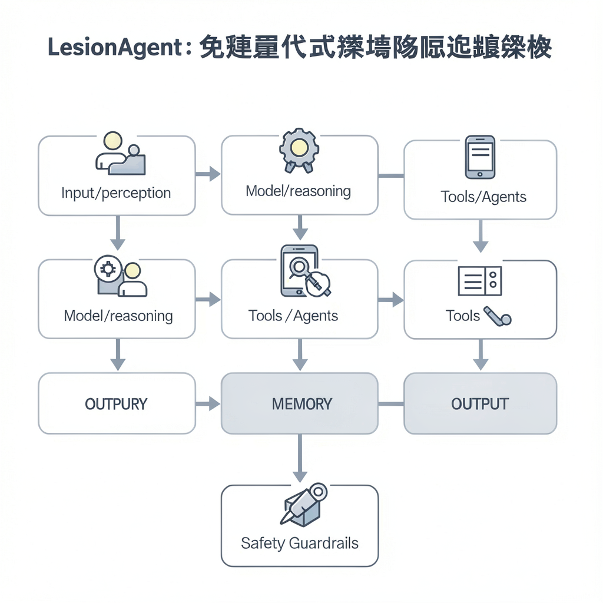

# AI 技術架構深度拆解：LesionAgent：免訓練代理式縱向影像追蹤架構

- 日期：2026-09-20
- 選題理由：選擇 LesionAgent，因為它展示免訓練的代理式架構，結合感知、推理、工具協作與長期記憶，能在縱向 CT 序列中自主追蹤腫瘤並評估療效，代表當前 Agentic AI 向臨床級應用邁進的關鍵範例。

## 一、架構原理與核心機制
架構包含五大層： 1. 輸入/感知層：接收 DICOM 格式的縱向 CT 影像序列，經預處理（去噪、配準、切片對齊）後轉為統一張量，並提取影像元資料（掃描時間、解剖標記）作為上下文。 2. 模型推理層：採用預訓練的醫學視覺基礎模型（如 MedSAM、Swin‑UNETR）進行零樣本分割與特徵嵌入，無需微調即可產生腫瘤候選區域與語意向量。 3. 工具/代理協作層：以 LLM 為核心控制器，依據推理結果動態調用工具——（a）幾何追蹤器計算質心位移與體積變化；（b）RECIST 規則引擎自動判定療效分類；（c）異常檢測模組標記新發病灶。代理以 ReAct 循環規劃下一步動作，並將中間結果寫入記憶。 4. 記憶/資料層：長期記憶儲存每次掃描的分割遮罩、特徵向量、臨床標註與代理決策日誌，採用向量資料庫支援相似度檢索，供後續推理參考歷史演變趨勢。 5. 輸出與監控層：產生結構化報告（JSON/FHIR）、可視化追蹤圖層、療效評估摘要；同時部署監控代理即時記錄推理延遲、工具調用成功率、異常觸發率，並支援人工覆核回饋寫入記憶以持續校準。整體流程為感知→推理→代理決策→工具執行→記憶更新→輸出，形成閉環。

## 二、海事領域應用（含實際例子）
1. 船殼縱向聲納/雷射掃描檢測：輸入多期船底三維點雲，感知層完成配準與去噪，推理層以預訓練點雲分割模型提取腐蝕、裂紋區域，代理協作層呼叫幾何追蹤器計算缺陷擴展速率、結構完整性指數，記憶層保存歷史缺陷演變，輸出維修優先級報告。價值在於將人工潛水檢查轉為自動化、可追溯的決策支援；風險包括水下感測器雜訊導致誤判、模型對新材質泛化不足。 2. 港口堆場貨櫃堆疊穩定度監控：輸入定時 LiDAR 與影像序列，感知層擷取貨櫃姿態與間隙，推理層以零樣本物件偵測定位貨櫃，代理層套用物理模擬工具評估傾倒風險，記憶層記錄歷史堆疊模式，輸出即時預警與調度建議。價值為提升作業安全與吞吐效率；風險在於環境光線變化與遮擋影響感知準確度。

## 三、醫療領域應用（含實際例子）
1. 腫瘤縱向療效評估（原論文場景）：輸入患者多期 CT，系統自動完成分割、追蹤、RECIST 判讀，輸出結構化報告供腫瘤科醫師參考，縮短人工輪廓繪製時間並降低觀察者間差異。合規風險涉及醫療器材軟體分類（FDA SaMD、台灣 TFDA）、資料隱私（HIPAA/個資法）與臨床驗證需求。 2. 糖尿病視網膜病變篩檢（ACCESS2 研究）：輸入連續眼底照相，感知層提取微血管病變特徵，推理層以基礎模型零樣本分類，代理層呼叫病變進展預測工具，記憶層保存患者長期影像軌跡，輸出篩檢陽性建議與轉診優先序。價值在於擴大基層篩檢覆蓋率；合規風險包含演算法偏誤對不同族群的公平性、臨床決策支援軟體認證。

## 四、其他產業應用（含實際例子）
1. 工業設備振動/熱像縱向監測：輸入感測器時間序列與紅外影像，感知層做特徵對齊，推理層以預訓練多模態模型零樣本異常檢測，代理層調用故障診斷知識圖譜生成維修工單，記憶層累積設備健康指數，輸出預測性維護排程。 2. 供應鏈庫存異常偵測：輸入多倉庫每日庫存快照與出入庫紀錄，感知層建立時空張量，推理層以基礎模型嵌入模式，代理層呼叫統計控制圖工具判斷缺貨/過量風險，記憶層保存歷史異常案例，輸出補貨建議與風險儀表板。

## 五、限制、風險與治理建議
免訓練代理依賴基礎模型零樣本能力，若目標領域與預訓練分佈差距大，分割與推理準確度會下降；工具鏈的決定論邏輯（如 RECIST）若規則更新需同步修改代理提示；長期記憶向量庫隨資料增長檢索延遲上升，需定期索引優化；醫療與海事等高風險場域仍需嚴格臨床/作業驗證與法規合規，無法直接以此架構替代人工專家判斷。

## 參考來源
- http://arxiv.org/abs/2611.27876v1
- https://pubmed.ncbi.nlm.nih.gov/43069285/
- https://tw.news.yahoo.com/ai%E7%B5%90%E5%90%88%E6%B5%B7%E4%BA%8B%E5%B0%88%E6%A5%AD%E9%96%8B%E5%89%B5%E8%88%AA%E9%81%8B%E6%96%B0%E5%B1%80-%E5%BC%B7%E5%8C%96%E7%87%9F%E9%81%8B%E6%B1%BA%E7%AD%96-%E5%AE%89%E5%85%A8%E7%AE%A1%E7%90%86%E8%88%87%E6%B8%9B%E7%A2%B3%E6%95%88%E7%9B%8F-100359130.html
- https://siliconangle.com/2026/11/23/aevius-labs-launches-with-22m-to-bring-understandable-intelligence-to-medical-data/
- https://github.com/whitecircle/halo
- https://github.com/maheshvaikri-code/snapllm
