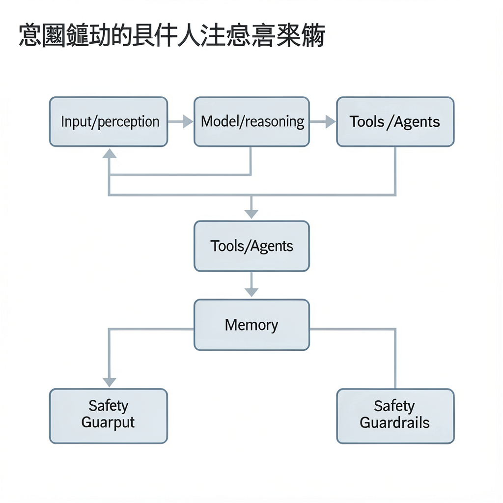

# AI 技術架構深度拆解：意圖驅動的具身人工智慧架構

- 日期：2026-09-27
- 選題理由：該論文提出「意圖驅動的具身人工智慧」架構，結合大型語言模型與感知‑動作循環，能在真實機器人與模擬環境中零樣本規劃長時程任務，代表當前具身 AI 從感知到決策的最新整合趨勢，故選為今日最具代表性架構。並展示如何透過意圖解析、技能庫檢索與閉環反饋實現跨場景泛化。

## 一、架構原理與核心機制
架構包含五大層級： 1. 輸入/感知層：多模態感測器（視覺、力覺、語音）經由編碼器轉為統一語義嵌入，並同步輸入意圖解析模組。 2. 意圖解析與規劃層：大型語言模型（LLM）接收自然語言指令與環境嵌入，輸出高層意圖圖與子目標序列；引入思維鏈提示使模型產生可執行的技能調用計畫。 3. 技能庫與工具/代理協作層：預先註冊的原子技能（抓取、導航、組裝）以標準化介面封裝，LLM 依計畫動態檢索並串聯技能，必要時啟動外部工具（地圖服務、物件偵測 API）或協作代理（多機器人協調器）。 4. 記憶/資料層：短期工作記憶儲存當前任務狀態、感測歷史與執行反饋；長期知識庫保存技能參數、環境地圖與歷史任務案例，支援檢索增強生成（RAG）與持續學習。 5. 輸出與監控層：執行器將技能指令轉為底層控制訊號；監控模組即時計算成功率、安全違規與延遲，並將指標回寫記憶層供後續規劃優化。整體形成感知‑意圖‑規劃‑執行‑反饋的閉環，支援零樣本泛化與線上適應。

## 二、海事領域應用（含實際例子）
1. 港口自動化裝卸機器人：輸入為貨櫃識別影像、堆場地圖與調度指令；系統解析「將 20 號貨櫃移至碼頭 A」意圖，規劃導航、抓取、堆疊技能序列，並即時監控碰撞風險。價值在提升吞吐量與減少人力；風障在惡劣天氣導致感測退化與通訊延遲。 2. 海上巡檢無人艇編隊：輸入為雷達/光學影像、海圖與巡檢任務清單；意圖層拆解為區域覆蓋、異常偵測、回傳報告等子目標，技能庫提供自主避障、目標鎖定、衛星通訊技能。價值為擴大巡檢範圍並降低人員風險；風險包含海況突變導致動力學模型失配與頻譜干擾。

## 三、醫療領域應用（含實際例子）
1. 手術室機械臂輔助系統：輸入為術中內視鏡影像、醫師語音指令與病患解剖模型；意圖解析將「分離血管」轉為精細抓取、切割、止血技能鏈，記憶層保存術中解剖變化供即時調整。價值在提高手術精度與縮短時間；合規風險涉及醫療器材認證（FDA/CE）與資料隱私（HIPAA）。 2. 遠端康復機器人陪伴：輸入為患者肢體動作捕捉、生理訊號與治療師處方；架構生成個人化訓練意圖，動態調整阻力、引導動作並記錄進度。價值為擴大居家照護覆蓋；風險包含演算法誤判導致過度訓練與跨國醫療法規差異。

## 四、其他產業應用（含實際例子）
1. 智慧倉儲揀選機器人：輸入訂單清單、貨架地圖與即時庫存感測；意圖層規劃最短路徑與抓取序列，技能庫提供視覺定位、真空吸附、避障技能，記憶層累積貨品特徵以加速後續任務。 2. 製造產線柔性組裝單元：輸入 CAD 模型、工單與機器視覺檢測結果；系統將「組裝零件 A+B」轉為定位、夾持、螺絲鎖付技能組合，並透過監控層即時檢測扭力與位置偏差，支援小批量多品種生產。

## 五、限制、風險與治理建議
架構高度依賴 LLM 的推理品質，若意圖解析錯誤將導致技能鏈失效；技能庫擴充需領域專家手動封裝，擴展成本較高；多模態感測融合在極端光照、雜訊環境下仍易產生語義錯位；長期記憶若缺乏有效遺忘機制會造成知識污染；部署邊緣裝置時模型量化可能損失規劃精度，需權衡算力與延遲。

## 參考來源
- https://pubmed.ncbi.nlm.nih.gov/43054956/
- https://pubmed.ncbi.nlm.nih.gov/43054954/
