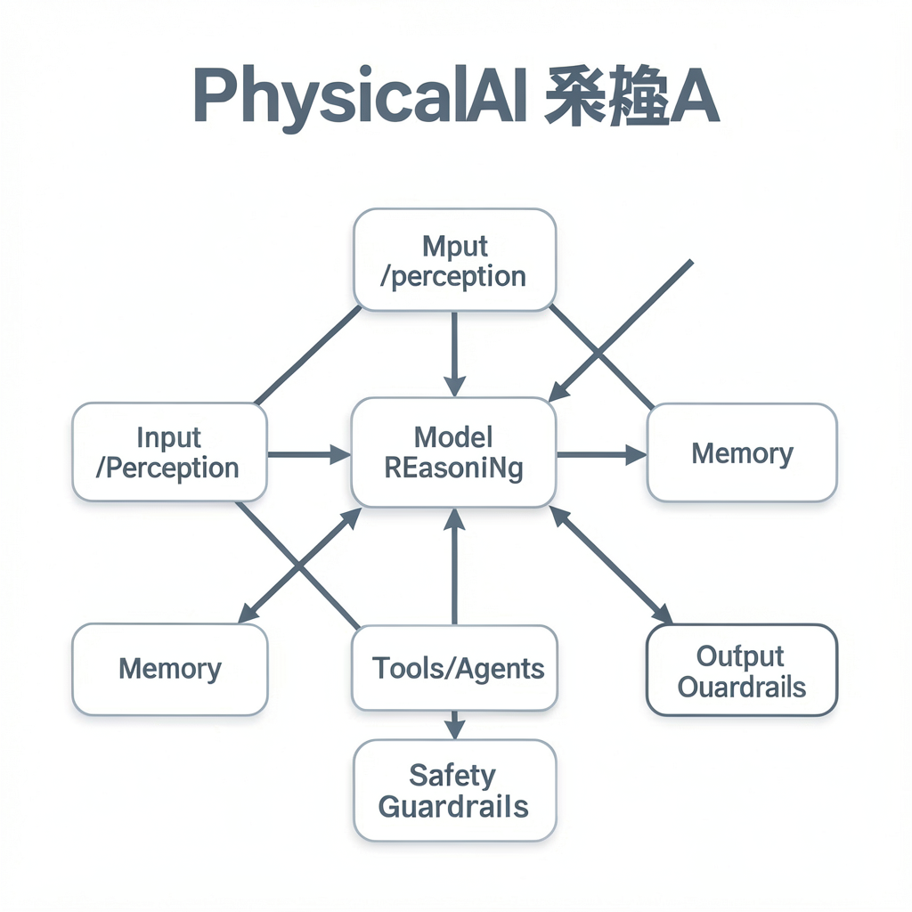

# AI 技術架構深度拆解：Physical AI 架構

- 日期：2026-10-04
- 選題理由：今日新聞出現國產 AI 無人船巡航與 AI 3D 醫療影像大會，且最新論文《Aligning Perception, Reasoning, Modeling and Interaction: A Survey on Physical AI》系統性提出感知‑推理‑建模‑互動四層架構，完整涵蓋實體環境下的自主決策，具代表性。

## 一、架構原理與核心機制
Physical AI 架構將自主系統拆解為五大核心層： 1. 輸入/感知層：融合多模態感測器（雷達、光學相機、LiDAR、超音波、醫療影像 DICOM）資料，經由時空對齊與去噪模組產生統一的環境表徵。 2. 模型推理層：採用大型基礎模型（視覺‑語言、多模態 Transformer）進行語義理解、場景圖建構與任務規劃；並引入思維鏈與工具調用機制，支援代碼生成、物理模擬查詢等外部工具。 3. 工具/代理協作層：將具體執行單元（推進器、機械臂、手術器械、邊緣推理節點）封裝為標準化技能 API，由高層規劃器動態編排、監控執行狀態並處理異常回滾。 4. 記憶/資料層：包含短期情境記憶（向量資料庫存放近期觀測與決策）、長期知識庫（領域本體、法規、醫學指南、海圖）與持久化日誌，支援持續學習與審計追蹤。 5. 輸出與監控層：產生可解釋的行動指令、風險評估報告與人機介面回饋；內建安全閘道、即時異常檢測與人工介入觸發機制，確保符合海事規範（IMO）、醫療法規（HIPAA、GDPR）與產業安全標準。

## 二、海事領域應用（含實際例子）
範例一：近海巡航無人船。輸入資料包含 AIS 船位、雷達回波、光學影像、海圖與氣象預報。系統於感知層完成目標檢測與航道語義分割，推理層生成避碰路徑並呼叫動力學模擬工具驗證，代理層下發推進器指令，記憶層記錄航跡供事後審計。價值在於 24 小時無人值守巡航、降低人力成本；風險包括感測器失效導致誤判、通訊中斷時的自主決策合法性。 範例二：智慧港口貨櫃調度。輸入為岸橋吊機視覺、堆場 RFID、排程系統資料。架構以多代理協作方式，規劃器協調多台 AGV 與吊機同步作業，工具層呼叫優化求解器即時重排。價值為提升吞吐量 15% 以上；風險在於異常貨物（危險品）識別錯誤可能引發連鎖停機。

## 三、醫療領域應用（含實際例子）
範例一：AI 輔助 3D 醫療影像診斷。輸入為 CT/MRI DICOM 系列、病歷文字、基因檢測報告。感知層執行體素分割與器官配準，推理層結合放射科知識圖譜生成初步報告並標註不確定區域，代理層將標註回傳 PACS 供醫師複核，記憶層保存模型版本與醫師修正供持續微調。價值為縮短報告時間 30%、提升早期病變偵測率；合規風險涉及醫療器材認證（TFDA、FDA）、患者資料去識別化與模型解釋義務。 範例二：手術數位雙生規劃與導航。輸入包含術前 3D 重建、術中導航追蹤、醫師語音指令。架構於推理層進行解剖結構語義推理與風險區域標記，工具層呼叫有限元素模擬評估切除邊界，代理層驅動機械臂輔助定位，監控層即時比對術中影像與計劃偏差並觸發警報。價值在於提高手術精度、減少併發症；風險包含即時延遲導致導航誤差、軟體缺陷可能造成醫療事故責任歸屬不明。

## 四、其他產業應用（含實際例子）
範例一：工業機械臂自適應檢測。輸入為 3D 視覺點雲、力覺回饋、生產排程。架構以感知層識別工件姿態與缺陷，推理層規劃抓取與檢測路徑並呼叫碰撞檢測工具，代理層控制機械臂執行，記憶層累積缺陷模式供品質分析。價值為減少人工檢測 40%、提升良率。 範例二：智慧城市交通信號優化。輸入包含路側雷達、車聯網 V2X 訊號、歷史流量。感知層融合多源流量估計，推理層以強化學習代理生成信號時制策略，工具層呼叫交通模擬器評估，監控層即時顯示 KPI 並允許人工覆寫。價值為降低平均延遲 12%、減少排放；風險在於模型對突發事件（事故、異常天氣）泛化不足。

## 五、限制、風險與治理建議
1. 多模態感知對齊在極端環境（強光、海霧、金屬伪影）仍易失效，導致下游推理錯誤。2. Sim‑to‑Real 差距使物理模擬工具驗證與實際執行存在偏差，需大量實地資料微調。3. 長期記憶與持續學習缺乏統一遺忘機制，易產生知識污染與隱私洩漏。4. 安全閘道與人工介入延遲在高速自主場景（如高速航行、手術）可能來不及生效。5. 計算資源需求大，邊緣部署需權衡模型蒸餾精度與即時性。6. 法規認證流程（IMO、FDA、ISO 13485）對架構變更審核嚴格，迭代週期長。

## 參考來源
- https://pubmed.ncbi.nlm.nih.gov/42284175/
- https://pubmed.ncbi.nlm.nih.gov/42118647/
- https://news.google.com/rss/articles/CBMia0FVX3lxTE5Xc0pKWm56M18wb3ZtNDk2NFJBRTBYUllKMkdwZVp3akVUT21kQTU0US1ycElxT1FCQTZmUDk4SnNZUTJZdUFRWGFkZmluRWgxUnJiV0hCa0Ffb0tzX01xRXo2MEhfMkowdXU4?oc=5
- https://news.google.com/rss/articles/CBMikgJBVV95cUxOVGRhVkVuRGpLYkhHNVctNUk5cXYxY1c5T19seFlmYnNBejRfSkgzWDFkWlBOWkUxNDZsckpqMHZBdnEyTU8zb005MjhxdGpUOE9WLXNMcHRLSER5MUlGWTZsa3ZJTzQ2WkJvQ0xtOFhuYmVsZ0Q1UEpzS1hVWHVxZW5tMG56RnFVSTRCWnZ2RTU2V1ozY3FuZXR4bkFmRkw5SXBZUTJfM2pLN0dFTTVxRS0tN3g0QXVSUl9kYmV1eDlqNkFoS0VsdGtNTTU2b2R0RXd1MTgxRTYxNVFQZFJzZDFsQXdQdy1CRFJRVlZrS0s3UDZRLXN3SzZWa1o1alVpdDNZd2tIRXZnS3RfNHFZNVVn?oc=5
- https://news.google.com/rss/articles/CBMihwFBVV95cUxQTXdhM0N4OXlGcmhPMnlUc0FLbFJ3b2dwcGQ1VjdxYjQxQ1RuMzdPSGJ5cjlXUmowWVBxcnJiUG1CbWtPdW1kSW1yZVN4SF83M2U5SEZ1VjRVNVJFZGpFVWVYQV9hUjcyWEpvWVBLVTRVb1pLT1BYaGZVUnVIX1RDREdHaFQ0VjA?oc=5
- https://github.com/XIAOJIE0519/E2E
