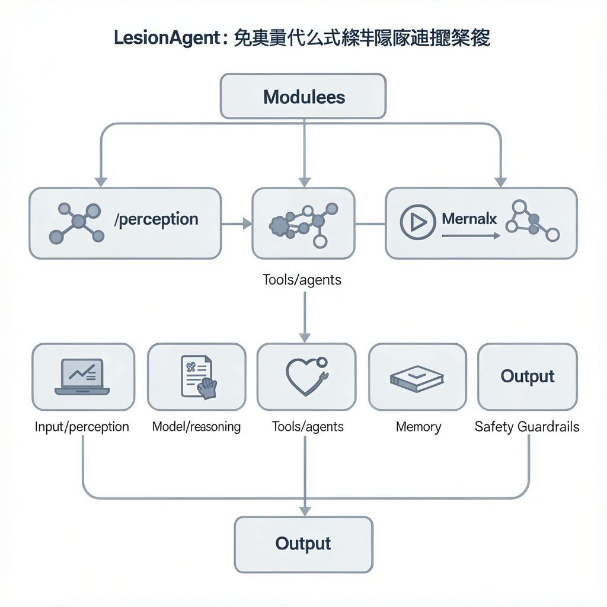

# AI 技術架構深度拆解：LesionAgent：免訓練代理式縱向影像追蹤架構

- 日期：2026-10-11
- 選題理由：今日素材同時出現論文與開源專案，LesionAgent 展示「免訓練代理式架構」在縱向醫療影像中的實戰落地。它結合大型語言模型推理、視覺工具鏈、長期記憶庫與自我驗證迴路，無需微調即可跨時間點追蹤腫瘤演變，代表當前 Agentic AI 從聊天機器人轉向專業領域長程推理的關鍵範式。

## 一、架構原理與核心機制
【輸入/感知】系統接收患者多時間點 CT 序列（DICOM），經預處理模組完成配準、分割與關鍵切面抽取，產生結構化影像特徵向量與元資料（時間戳、序列協定）。 【模型推理】核心為免訓練 LLM 代理，採用 ReAct 風格推理：觀察→思考→行動→觀察。代理根據當前影像特徵與歷史記憶，生成自然語言推理鏈，判斷腫瘤是否進展、縮小或穩定。 【工具/代理協作】代理可調用：(1) 影像測量工具（RECIST 1.1 直徑計算、體積分割）；(2) 影像檢索工具（向量資料庫檢索相似歷史病例）；(3) 知識查詢工具（臨床指南、文獻 RAG）；(4) 視覺語言模型驗證器（交叉驗證分割品質）。多工具協作透過統一工具介面與狀態機編排。 【記憶/資料層】雙層記憶：短期工作記憶保存當前輪次的觀察、工具輸出與推理草稿；長期情景記憶以向量資料庫儲存患者完整縱向軌跡（影像嵌入、測量值、代理判斷、醫師修正），支援跨就診的上下文連續性。 【輸出與監控】輸出結構化報告：腫瘤回應評估（RECIST 分類）、關鍵影像標註、推理溯源鏈、信心分數。監控層包含：(1) 幻覺偵測器（交叉驗證工具輸出與 VLM 判讀）；(2) 漂移警報（連續時間點判斷邏輯不一致）；(3) 審計日誌（完整工具調用鏈與提示詞版本），支援醫師複核與合規追溯。

## 二、海事領域應用（含實際例子）
【情境 1：船體結構縱向腐蝕/裂紋監測】輸入：定期無人機/爬壁機器人拍攝的船體高解析影像序列（可見光+紅外）、船舶載重歷史、海域環境鹽度/溫度日誌。系統運作：代理以免訓練方式比對多時間點影像，呼叫裂紋分割工具量測長寬深演變，檢索相似船型腐蝕案例庫，結合載重應力模型推論疲勞增長率，輸出分級預警與檢修優先序。價值：將人工潛水檢查週期從年縮至月，降低結構失效風險。風險：海洋環境光照/濁度變異大，影像配準誤差可能導致假性增長判讀；需建立領域適配的影像增強前處理。 【情境 2：港口堆場貨櫃/散裝貨堆體積變化追蹤】輸入：定時衛星/定點攝影機影像、港口作業系統（TOS）進出閘紀錄、氣象資料。系統運作：代理對齊多時相正射影像，呼叫體積估算工具計算堆高/面積變化，交叉驗證 TOS 紀錄一致性，自動偵測異常堆存（未申報危險品、超期貨物）。價值：提升港口吞吐透明度、減少貨物滯留糾紛。風險：衛星重訪週期與雲層遮蔽造成時間序列缺口，代理需具備不完整序列推理能力。

## 三、醫療領域應用（含實際例子）
【情境 1：轉移性肺結節縱向追蹤（RECIST 1.1）】輸入：患者每 8-12 週一次低劑量胸部 CT、既往放療/標靶治療紀錄、基因突變檢測報告。系統運作：代理自動配準基線與追蹤影像，呼叫結節分割與直徑測量工具，計算目標病灶長徑變化率，檢索相似基因型患者療效曲線，輸出「完全緩解/部分緩解/穩定/進展」分級與信心區間，標註新發病灶候選區供醫師複核。價值：縮短放射科醫師讀片時間 40% 以上，減少測量者間變異。合規風險：屬 FDA SaMD（醫療器材軟體）Class II，需 510(k) 許可；臨床決策最終須醫師簽署，代理僅提供輔助證據。 【情境 2：腦轉移瘤立體定向放療（SRS）後壞死與復發鑑別】輸入：SRS 後 3/6/12 月 MRI（T1增強、T2、DWI、灌注）、治療計劃劑量分佈圖。系統運作：代理融合多序列影像，呼叫灌注參數（rCBV）計算工具與擴散特徵提取器，對比劑量邊緣區域訊號演變，查詢 RANO-BM 判讀準則與文獻，輸出「假性進展/真性復發」機率分布與建議追蹤間隔。價值：降低不必要開顱切片風險。合規風險：假性進展誤判為復發可能導致過度治療；需嚴格驗證假陰性率，並在報告明確標示「僅供參考」。

## 四、其他產業應用（含實際例子）
【情境 1：風力發電機葉片損傷縱向監測】輸入：定期無人機巡檢影像（可見光/熱紅外）、SCADA 振動/功率曲線、氣象站風速/湍流資料。代理比對多期影像量測前緣侵蝕、雷擊痕跡擴展，關聯振動頻譜異常，輸出剩餘壽命預測與停機檢修建議。價值：從定期維修轉向狀態基礎維修（CBM），降低非計畫停機損失。 【情境 2：半導體晶圓缺陷演變追蹤（製程監控）**輸入：多層次製程後的光學/電子束檢測影像序列、製程參數日誌（溫度、壓力、氣體流量）。代理對齊同一晶圓不同製程站影像，追蹤微小缺陷是否擴大、合併或被後續製程覆蓋，關聯參數漂移找出根因，輸出良率影響評估。價值：縮短良率學習曲線，減少報廢成本。

## 五、限制、風險與治理建議
1. 免訓練代理高度依賴基座 LLM 的領域知識與推理能力，若基座模型缺乏專業醫學/工程知識，推理鏈易產生邏輯跳躍。2. 影像配準與分割工具的系統性誤差會級聯放大，導致縱向量測漂移；需引入不確定度量化與人工介入閾值。3. 長期記憶庫隨患者/資產累積增長，向量檢索延遲與儲存成本上升，需設計分層歸檔策略。4. 監管合規上，免訓練架構難以提供傳統驗證所需的固定模型權重與效能基準，監管機構可能要求鎖定特定基座模型版本並執行鎖定後驗證。5. 提示詞注入與工具濫用風險：惡意構造的影像元資料或外部知識庫可能誘導代理輸出錯誤判斷，需加強輸入清洗與工具輸出簽名驗證。

## 參考來源
- http://arxiv.org/abs/2611.27876v1
- https://github.com/MIC-DKFZ/LesionAgent
- https://medicalxpress.com/news/2026-11-ai-medical-imaging-picture.html
- https://finance.yahoo.com/technology/ai/articles/ferrum-health-selected-enterprise-imaging-192700164.html
- https://pubmed.ncbi.nlm.nih.gov/43069285/
- https://www.moneydj.com/kmdj/news/newsviewer.aspx?a=7f106899-b8a7-4aca-9994-941f5128b35f
