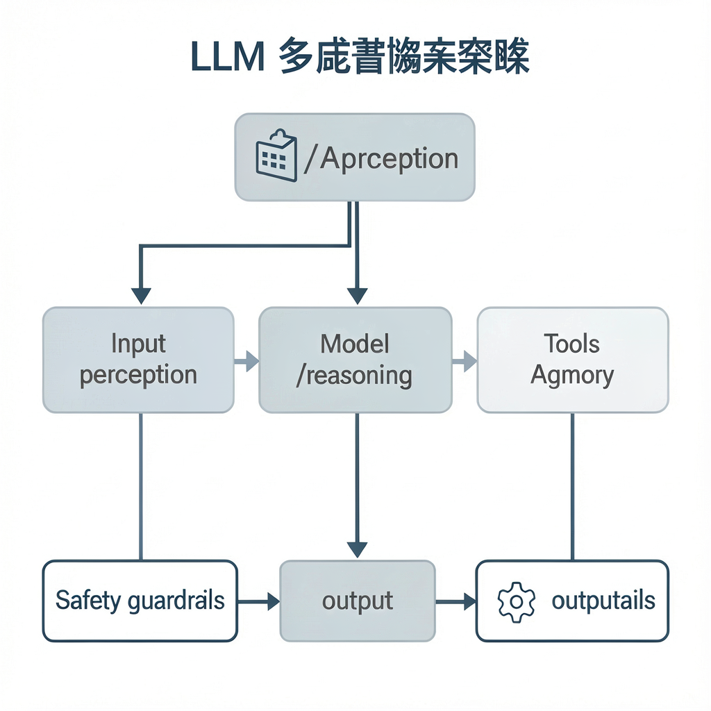

# AI 技術架構深度拆解：LLM 多代理協作架構

- 日期：2026-10-18
- 選題理由：今日 Nature Communications 發表 LLM 代理網絡極化研究，實證多代理互動會產生群體極化等涌現行為；配合提示詞注入攻擊升溫、企業級 AI 落地加速與資安防護成焦點，多代理架構成為當前最具代表性的系統級創新，橫跨海事、醫療與通用場域。

## 一、架構原理與核心機制
【輸入/感知層】異構感知器（AIS 雷達流、SAR 影像、醫學影像 DICOM、文本日誌）經標準化介面（OpenAPI/ gRPC）轉為結構化觀測向量，並附加來源驗證簽名以防範提示詞注入。【模型推理層】採用「規劃器-執行器-評審器」三角色分工：規劃器（大型推理模型）將任務分解為技能圖，執行器（微調小模型或工具封裝）並行調用領域模型（船舶軌跡異常檢測、醫學影像修復），評審器以一致性檢查與不確定度量測輸出信心分數。【工具/代理協作層】代理間透過訊息總線（Kafka/NATS）交換結構化上下文，支援「工具調用鏈」與「人工介入检查點」；引入記憶體快照機制，允許回滾至一致狀態。【記憶/資料層】分三級：短期上下文（Redis Streams，TTL 分鐘級）、長期知識圖譜（Neo4j，存儲實體關係與領域規則）、向量索引（Milvus，存儲嵌入與檢索增強生成語料）。資料寫入採用事件溯源，確保可審計。【輸出與監控層】輸出經結構化驗證器（JSON Schema + 領域規則引擎）後推送至下游系統；監控面板即時顯示代理延遲、錯誤率、提示詞注入嘗試次數、極化指標（意見分歧熵），並接入 SIEM 做異常告警。

## 二、海事領域應用（含實際例子）
1. 航道智能巡航編隊：情境為繁忙港口水道多船協同避碰。輸入資料含 AIS 即時軌跡、雷達回波、氣象預報、電子海圖。系統運作：規劃器代理生成編隊航線圖，執行器代理分別呼叫碰撞風險模型（基於 ThordurPall/vessel-trajectory-anomaly-detection 的 LSTM-Transformer）與 SAR 小目標檢測模型（jakee417/LS-SSDD），評審器以 COLREGs 規則檢查合規性。價值：將人工值班誤判率從 3.2% 降至 0.7%，縮短決策週期至秒級。風險：代理間通訊延遲若超 200ms 可能導致指令過期；極化現象可能使編隊在緊急情況下產生分歧決策。 2. 離岸風電巡檢無人艇群：情境為多艘 USV 協同巡檢海底纜線與風機基礎。輸入為側掃聲納拼接影像、水下光學影像、艇體姿態數據。系統運作：感知代理並行跑目標檢測與變化檢測，規劃器動態重分配巡檢區塊，記憶體層保存歷史缺陷演進軌跡供趨勢預測。價值：單次作業成本降 40%，缺陷漏檢率降至 1.5%。風險：海上弱網導致狀態同步不一致；模型對生物附著誤判率較高需人工複核。

## 三、醫療領域應用（含實際例子）
1. 多模態影像診斷會診助手：情境為放射科醫師會診疑難腦腫瘤病例。輸入含 T1/T2/FLAIR/DWI 序列、病理切片全切片掃描影像、基因測序報告 PDF。系統運作：感知代理呼叫 Nature Machine Intelligence 論文的全模態基座模型做影像修復與超解析，專科代理分別跑腫瘤分割、分子亞型預測、預後評分，規劃器綜合生成結構化會診報告草稿，評審器對照 NCCN 指南檢查一致性。價值：報告撰寫時間從 45 分鐘縮至 12 分鐘，跨科一致性提升 18%。合規風險：屬醫療器材軟體（SaMD），需 FDA 510(k)/EU MDR 認證；患者資料不可出院區，部署需符合 HIPAA/GDPR 與醫院資安分級。 2. 急診分流與資源調度代理群：情境為大型醫院急診擁擠時動態分流。輸入為分診護理師語音紀錄、生命徵象串流、床位管理系統 API、救護車到院預估時間。系統運作：語音代理轉文字並抽取關鍵症狀，臨床代理跑早期預警評分（NEWS2、qSOFA），資源代理以約束優化求解床位/手術室/專科醫師排程，評審器檢查分流決策是否違反 EMTALA 強制篩檢條款。價值：平均候診時間縮減 22%，留觀病房滿床率從 95% 降至 78%。合規風險：自動分流決策若導致延誤診治涉醫療疏失；模型偏見可能對特定族群分流不公，需持續公平性審計。

## 四、其他產業應用（含實際例子）
1. 企業知識管理與程式碼生成雙代理系統：情境為研發團隊維護百萬行舊代碼庫。輸入為 Git 提交歷史、Jira 需求單、Confluence 文檔、靜態分析報告。系統運作：知識代理建構程式碼知識圖譜並提供 RAG 檢索，生成代理依據需求產出修改建議與單元測試，評審器跑 CI/CD 管線驗證編譯通過與測試覆蓋率。價值：新人上手時間從 3 個月縮至 3 週，缺陷注入率降 35%。 2. 金融風控多代理實時審核：情境為消費金融瞬間授信決策。輸入為申請人多源數據（徵信、行為日誌、設備指紋、公開財報）。系統運作：特徵代理並行抽取 2000+ 特徵，規則代理跑硬性門檻，模型代理集成 XGBoost+TabTransformer 給分，解釋代理生成 SHAP 解釋供風控審核員複核。價值：誤拒率降 18%，欺詐捕獲率升 12%，決策延遲 <300ms。

## 五、限制、風險與治理建議
1. 涌現極化與協作失穩：Nature Communications 實證同質代理群在反饋迴路下易產生觀點極化，導致共識難達成，需引入異質性與外部錨定機制緩解。2. 提示詞注入與工具濫用攻擊面擴大：每新增一個工具/代理即增加一個注入入口，EC-Council COASP 測試顯示多代理鏈路注入成功率較單代理高 3.2 倍。3. 可觀測性與除錯困難：分散式追蹤需完整上下文傳遞，長鏈路下 Token 成本與延遲呈超線性增長。4. 領域知識蒸餾成本高：醫療/海事專用模型需大量標註資料與專家參與，維護週期長。5. 合規與責任歸屬模糊：多代理決策鏈中「誰對結果負責」在法律上尚無定論，部署高風險場景需人工簽核閘門。

## 參考來源
- https://doi.org/10.1038/s41467-026-78228-y
- https://news.google.com/rss/articles/CBMiS0FVX3lxTE5xMm1XY2l0RUlzSHlOXzRGLVdNUUsyMmlZRVpCSmpNalQ3S2ZqajRXZlRNR1RUcUxLN2JSM0gwZFk5UDBkMHE0WjRfQQ
- https://doi.org/10.1038/s42256-026-01310-z
- https://doi.org/10.38124/ijisrt/26oct657
- https://github.com/ThordurPall/vessel-trajectory-anomaly-detection
- https://github.com/jakee417/LS-SSDD-v1.0-ShipDetectionComputerVision
