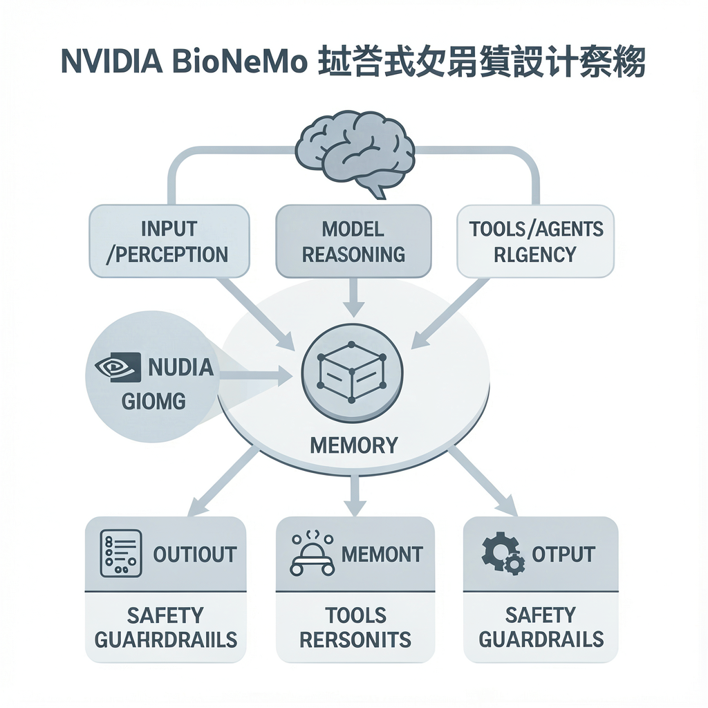

# AI 技術架構深度拆解：NVIDIA BioNeMo 生成式蛋白質設計架構

- 日期：2026-10-25
- 選題理由：選擇NVIDIA BioNeMo因其提供預訓練蛋白質語言模型(ESM、ProtT5)、AlphaFold2結構預測與生成式擴散模型，支援多GPU擴展訓練與推理，整合Clara醫療生態系，可加速從序列設計到結構驗證的完整流程，大幅降低生物製藥研發門檻與算力成本。

## 一、架構原理與核心機制
架構包含五大層： 1. 輸入/感知層：接收蛋白質一級序列、多序列比對 (MSA)、結構座標、實驗約束 (如結合位點、理化性質) 等多模態資料，經過 Tokenizer 轉為離散 token 序列。 2. 模型推理層：核心為基於 Transformer 的大規模生成式模型 (如 MegaMolBART 或 Diffusion Transformer)，採用預訓練 + 微調範式，支援條件生成 (conditional generation) 以滿足功能性設計需求；推理時採用 beam search 或 sampling 並輸出機率分佈。 3. 工具/代理協作層：生成的候選序列自動送入下游工具鏈，包括分子對接 (AutoDock Vina)、分子動力學模擬 (OpenMM)、溶解度/免疫原性預測模型，並由代理 (agent) 根據評分進行迭代優化或人工介入。 4. 記憶/資料層：維護預訓練權重、蛋白質資料庫 (UniProt、PDB)、用戶自定義約束庫、歷史設計紀錄與版本控制，支援增量學習與知識蒸餾。 5. 輸出與監控層：輸出結構化 JSON 包含序列、預測結構 (pLDDT)、信心分數、功能預測指標；內建監控儀表板追蹤生成多樣性、約束滿足率、計算資源使用與異常偵測，確保可重現與審計。

## 二、海事領域應用（含實際例子）
1. 防汙肽設計：情境為商船船體塗料研發，輸入目標汙染生物 (藤壺、藻類) 表面蛋白質結構與環境鹽度/溫度約束，系統生成具高親和力且低毒性的短肽序列，經對接與 MD 驗證後供實驗合成，價值在減少燃油消耗與維護成本，風障在肽段在真實海水中穩定性未經大規模驗證。 2. 艙底水處理酵素工程：情境為壓艙水排放合規，輸入目標污染物 (如入侵物種 DNA、有機污染物) 結構，系統設計可在低溫、高鹽條件下高活性的水解酵素，經模擬篩選後導入生物反應器，價值為降低化學藥劑使用，風障為酵素在複雜水質中失活及監管審查。

## 三、醫療領域應用（含實際例子）
1. 抗癌抗體從頭設計：情境為針對特定腫瘤抗原 (如 HER2 新表位) 開發治療性抗體，輸入抗原結構、表位映射、親和力與交叉反應性約束，系統生成完整重鏈/輕鏈序列並預測結構，經體外親和力成熟流程加速 IND 申報，價值為縮短發現週期 6-12 個月，合規風險在免疫原性預測與 GMP 製程一致性。 2. 放射性藥物優化與放療規劃：情境為西門子醫療合作開發 Lu-177 標記肽段，輸入受體結構、腎臟清除率、劑量分佈限制，系統同步生成螯合肽序列並輸入治療規劃系統進行劑量模擬，價值為提高腫瘤吸收劑量並降低腎毒性，合規風險涉及輻射安全標準與臨床試驗設計。

## 四、其他產業應用（含實際例子）
1. 工業生物催化酵素設計：化工廠需在高溫、有機溶劑環境下催化特定反應，輸入反應機制與操作條件，系統生成耐熱耐溶劑酵素變體，經高通量篩選後替代傳統化學催化劑，降低能耗與廢棄物。 2. 可降解材料蛋白質聚合物設計：包裝材料公司欲開發海洋可降解膠囊，輸入目標機械強度、降解酵素識別位點、生產宿主限制，系統輸出可表達於大腸桿菌的蛋白質聚合物序列，加速材料原型驗證。

## 五、限制、風險與治理建議
模型對罕見折疊或多域蛋白質的生成品質仍有波動，易產生幻覺序列導致下游實驗失敗；訓練資料偏向已知結構，對新型結構泛化能力有限；大規模推理需多張 GPU，成本高且碳排放不可忽視；醫療應用面臨 FDA/EMA 對 AI 生成產品的驗證框架尚未成熟，合規路徑不明；海事與工業場景缺乏大量實證數據支撐長期穩定性評估。

## 參考來源
- https://news.google.com/rss/articles/CBMiaEFVX3lxTE5UWmoxRkxfcmFveXVkQ1hxTF9QeHJweGEzQlY2cVdQNGVLY25rbG9qNEtkUkhFV0NTLU1LYzhJa2Z5S1Noc2hEMmlFdVV5eWVPcG4yTEVYRlAxUXIwTTF5N3VFMEFhR3Fh
- https://news.google.com/rss/articles/CBMiTkFVX3lxTE9zSE1XdjZuN0dMelFRLWtWLWVJaXJVUTNtMF8zSDlrYlBnNXdFUVFiUkhDNGdNUVVoYUlmQ0ttdmJ1WWZkSWdlMWU0bUpQZw
- https://pubmed.ncbi.nlm.nih.gov/43073404/
- https://doi.org/10.1016/j.oceaneng.2026.129067
- https://github.com/ThordurPall/vessel-trajectory-anomaly-detection
- https://github.com/jakee417/LS-SSDD-v1.0-ShipDetectionComputerVision
