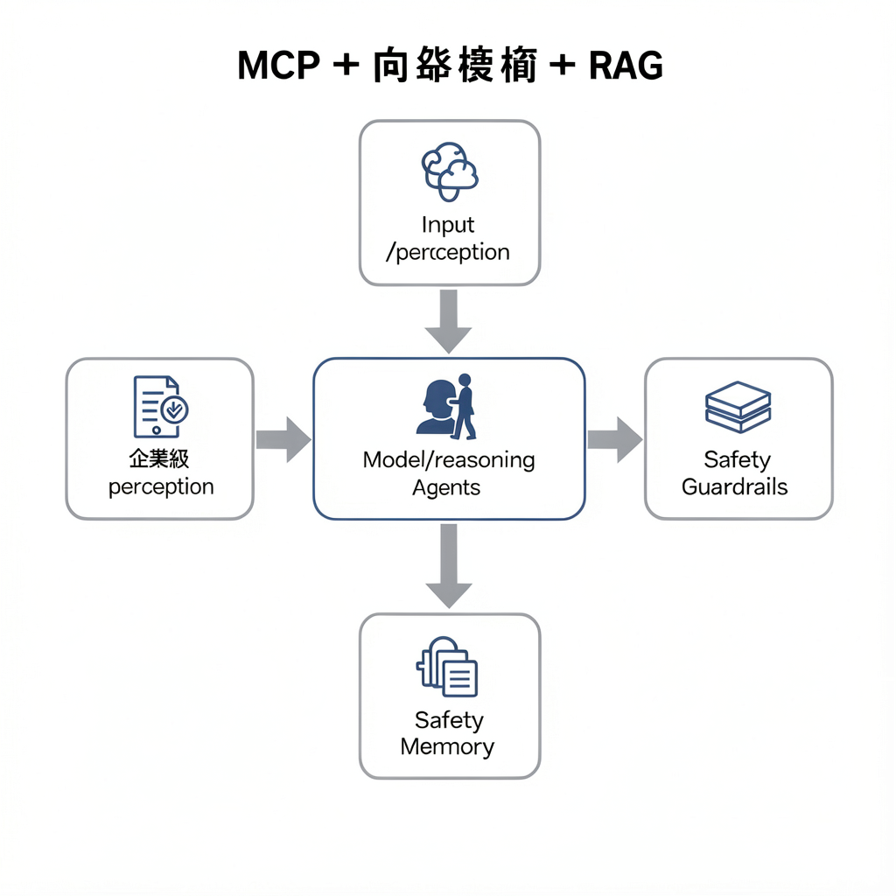

# AI 技術架構深度拆解：企業級 AI Agent 架構（MCP + 向量搜尋 + RAG）

- 日期：2026-11-01
- 選題理由：今日新聞明確介紹從 LLM 到企業級 AI Agent 的完整技術棧，涵蓋 MCP 協定、向量搜尋與 RAG，具體說明元件與資料流，適合作為最新架構深度拆解的代表。

## 一、架構原理與核心機制
【輸入/感知】使用者請求或事件先經由 API Gateway 進入，經過意圖識別模組轉為結構化指令。【模型推理】核心 LLM 依據指令進行推理，並透過 Model Context Protocol (MCP) 統一管理上下文、工具描述與權限。【工具/代理協作】MCP 定義標準化工具介面，Agent 可動態調用向量搜尋服務、知識庫 RAG、外部 API 或自定義腳本，多 Agent 之間透過訊息總線協作完成複雜任務。【記憶/資料層】短期記憶存於會話上下文，長期知識儲存於向量資料庫（如 Milvus/Weaviate）與關係型資料庫，支援增量更新與版本控制。【輸出與監控】執行結果經由輸出格式化模組回傳給使用者，同時記錄追蹤 ID、延遲、Token 用量與錯誤碼至可觀測平台（Prometheus/Grafana），支援自動化告警與人工審核。

## 二、海事領域應用（含實際例子）
1. 航線優化助理：輸入船舶 AIS 軌跡、天氣預報、港口作業窗口；Agent 透過向量搜尋歷史最佳路徑、RAG 查詢法規限制，再呼叫優化演算 API 產生建議航線，價值在降低燃油 5‑8% 並縮短靠泊等待，風險為模型對極端天氣預測不足可能導致建議失效。2. 故障預測與維修調度：輸入引擎感測器串流、維修紀錄、備件庫存；Agent 以 RAG 檢索故障模式、向量搜尋相似案例，結合預測模型輸出維修優先序與備件調撥單，價值為減少非計畫停機 30%，風險在感測器資料品質不佳導致誤判。

## 三、醫療領域應用（含實際例子）
1. 臨床決策輔助：輸入病人電子病歷、影像報告、最新指引文獻；Agent 透過向量搜尋相似病例、RAG 擷取指引條文，LLM 綜合生成診斷建議與用藥劑量，價值為提升診斷一致性並縮短醫師查閱時間，合規風險在建議若未經醫師核簽可能違反醫療法規。2. 藥物不良反應監測：輸入藥品上市後監測資料庫、社群媒體討論、文獻摘要；Agent 以向量搜尋聚類相似不良事件、RAG 擷取機制研究，自動生成風險報告供藥監單位審閱，價值為加速訊號偵測，風險在資料來源偏差可能產生假陽性。

## 四、其他產業應用（含實際例子）
1. 客服智能路由：輸入客戶對話紀錄、產品知識庫、SLA 規則；Agent 以向量搜尋最佳解答片段、RAG 確認政策條款，自動生成回覆或轉派人工，提升首次解決率並降低人力成本。2. 程式碼生成與審查平台：輸入需求文件、現有代碼庫、編碼規範；Agent 透過向量搜尋相似模組、RAG 擷取最佳實踐，LLM 產生程式碼並自動執行靜態分析，加速開發週期並保持品質一致。

## 五、限制、風險與治理建議
架構依賴高品質向量索引與 RAG 知識庫，資料更新滯後會導致幻覺；MCP 仍屬新興標準，工具生態相對有限，整合成本高；多 Agent 協作易產生競態與死循環，需嚴格的編排與監控；隱私敏感資料跨服務傳輸需加密與合規審查，增加部署複雜度。

## 參考來源
- https://news.google.com/rss/articles/CBMiS0FVX3lxTE9hdHhmLTQyLXQ4NU1qMnkycFVYcW5jRXZSMndWUF9aX05sQ1JHNEU4N0ZMSGw4cFpPcG43NC14VGxGVkdaU0k3V1AtYw?oc=5
- https://pubmed.ncbi.nlm.nih.gov/43064736/
- https://news.google.com/rss/articles/CBMiTkFVX3lxTE4wNUhPVVpTMEZOR25wOEhwb0pGenFyWDBmU09nc01zZkRKeFZVUXB0MFBBX0FsMVRkQ3FHV1hhaE4tSWtmbDctSk1Jckt5UQ?oc=5
