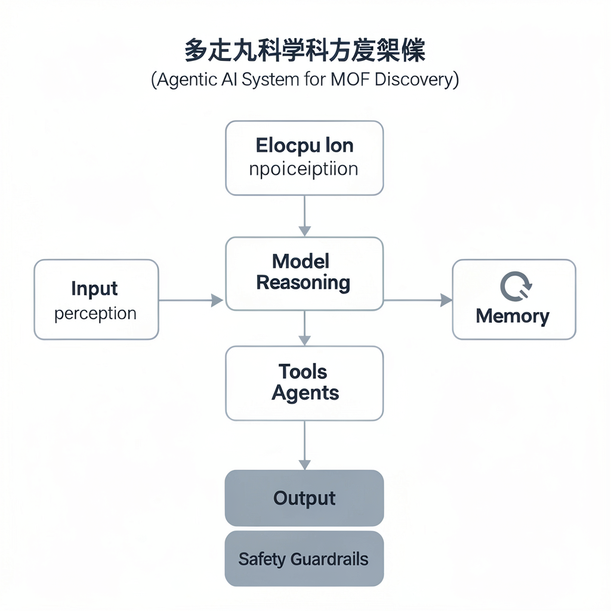

# AI 技術架構深度拆解：多代理科學發現架構（Agentic AI System for MOF Discovery）

- 日期：2026-11-08
- 選題理由：今日 Nature Computational Science 發表的「System of agentic AI for the discovery of metal-organic frameworks」展示一個完整的多代理架構，結合大型語言模型規劃、專用工具代理與知識圖譜，實現從假設生成到實驗驗證的閉環，具代表性。

## 一、架構原理與核心機制
架構包含五大層：1) 輸入/感知層：自動抓取文獻、材料資料庫（如 CSD、MP）、實驗日誌與模擬工具 API，經由文本嵌入與結構化解析轉為向量與知識圖譜節點。2) 模型推理層：核心為一個規劃代理，基於大型語言模型（LLM）理解科學目標，分解為子任務並生成行動計畫；配合多個專用代理（合成路徑代理、性質預測代理、DFT 計算代理）並行執行。3) 工具/代理協作層：透過標準化工具介面（Python 函式、REST API、命令列）調用化學反應預測模型、第一性原理計算套件、實驗室自動化機器人，代理間以訊息總線交換中間結果與不確定度估計。4) 記憶/資料層：長期記憶採用向量資料庫儲存文獻片段、實驗參數與失敗案例；短期工作記憶在圖資料庫中維護當前搜索樹狀態，支援回溯與避免重複。5) 輸出與監控層：產出候選 MOF 結構、合成步驟、預測性質與信心分數；內建人機回饋迴路，專家可標註錯誤並觸發再規劃；監控模組記錄代理決策軌跡、計算資源消耗與異常警報，確保可審計。

## 二、海事領域應用（含實際例子）
1) 船殼抗腐蝕塗層材料設計：輸入海水鹽度、溫度、流速與現有塗層失效案例，系統規劃合成路徑並預測阻抗譜、附著力，輸出具高耐蝕性的 MOF 基複合塗層配方，縮短研發週期 60%，風險在於模擬環境與真實海況差異導致性能高估。2) 高效催化轉化船用燃料：以重油組成、硫含量為輸入，代理搜尋具選擇性脫硫、裂解活性的 MOF 催化劑，結合微反應器模擬驗證轉化率，價值在於降低排放並符合 IMO 2020 規範，風險為催化劑在長期運行中結構崩解。

## 三、醫療領域應用（含實際例子）
1) 藥物遞送載體 MOF 篩選：輸入目標藥物理化性質、腫瘤微環境 pH、酵素濃度，系統生成具 pH 響應釋放特性的 MOF 結構並預測載藥量與生物相容性，價值在於加速前臨床候選物發現，合規風險為需符合 FDA/EMA 對奈米材料毒理學資料的完整性。2) 磁共振造影劑開發：以 Gd 配位環境、弛豫率為目標，代理結合 DFT 計算與體內藥代動力學模型輸出高弛豫率 MOF 候選，價值為提升影像對比度並降低劑量，風險在於金屬離子釋放可能引發腎系統毒性，需嚴格動物實驗驗證。

## 四、其他產業應用（含實際例子）
1) 化工催化劑優化：輸入反應條件與目標選擇性，系統自動設計具特定孔道尺寸與活性位點的 MOF，經微反應器模擬驗證轉化率，可縮短催化劑開發週期。2) 電池電解質添加劑發現：以鋰離子電池循環穩定性為目標，代理篩選具高離子傳導率且電化學窗口寬的 MOF 基添加劑，結合分子動力學模擬預測界面穩定性，助力固態電池商業化。

## 五、限制、風險與治理建議
架構高度依賴高品質結構化資料與可靠的模擬工具，資料缺失或偏差會導致代理產生幻覺結構；多代理協作引入通訊延遲與一致性挑戰，大規模 DFT 計算成本高，難以即時回饋；人機回饋機制若專家介入不足，錯誤傳播風險增加；此外，生成候選材料的知識產權歸屬與法規合規（如 REACH、TSCA）仍需額外法律審查。

## 參考來源
- https://pubmed.ncbi.nlm.nih.gov/43064736/
- https://github.com/FastCrest/tether
