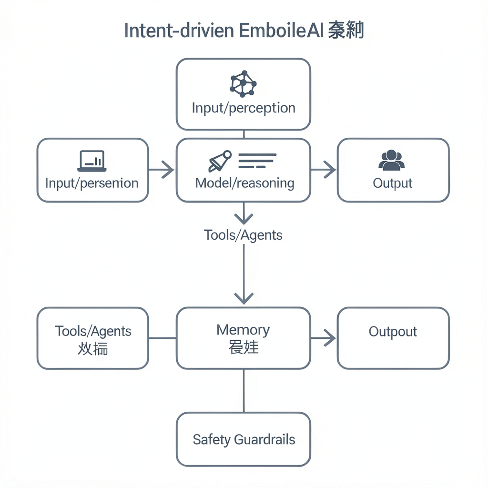

# AI 技術架構深度拆解：Intent-driven Embodied AI 架構

- 日期：2026-11-15
- 選題理由：今日發表於《National Science Review》的「Intent-driven embodied artificial intelligence」論文，提出一種以意圖為核心、整合感知、規劃、工具調用與長期記憶的具身智能架構，代表當前具身 AI 從單一任務走向通用自主的最新技術方向。

## 一、架構原理與核心機制
架構包含五大層級： 1. 輸入/感知層：多模態感測器（視覺、力覺、語音、雷達）經由統一編碼器轉為語義向量，並附加時空標記。 2. 意圖理解與推理層：大型語言模型（LLM）結合領域知識圖譜，將自然語言指令或隱性目標解析為結構化意圖圖，再由分層策略網絡分解為子任務序列。 3. 工具/代理協作層：維護技能庫（抓取、導航、檢測、通訊等），每項技能封裝為可調用的微服務，透過標準化 API 與推理層交互，支援動態組合與並行執行。 4. 記憶/資料層：短期情景記憶（近期觀測與動作軌跡）與長期語義記憶（任務經驗、環境地圖、法規知識）採用向量資料庫與圖資料庫混合存儲，支援檢索增強生成（RAG）與持續學習。 5. 輸出與監控層：動作指令經安全審核模組（碰撞預測、合規檢查）後下發至執行器；同時將執行結果、異常事件寫入監控日誌，供離線分析與線上策略微調。 資料流：感知→編碼→意圖解析→任務分解→技能調度→動作執行→結果回寫記憶。控制流採用事件驅動的有限狀態機，確保在不確定環境中能即時重新規劃。部署考量：邊緣端部署輕量感知與策略推理，雲端負責大模型微調與知識庫同步，需解決低延遲通訊、模型版本一致性與資料隱私合規。

## 二、海事領域應用（含實際例子）
1. 自主貨櫃船靠泊輔助：輸入多波束聲納、視覺相機、AIS 船舶自動識別系統資料；系統即時感知碼頭幾何與周邊船舶動態，意圖層解析「安全靠泊」目標，分解為航向調整、推進器控制、繫纜作業等子任務，調用導航與機械臂技能，輸出推進器轉速與繫纜機指令，並由安全審核模組檢查碰撞風險。價值：降低人為操作誤差、縮短靠泊時間；風險：感測器在惡劣海況下失效、模型對罕見情境泛化不足。 2. 港口自動化堆場搬運機器人：輸入激光雷達、RFID 標籤、調度系統下發的任務單；意圖層理解「將特定貨櫃移至指定區塊」，規劃路徑避開動態障礙，協作叉車技能與升降技能，記憶層記錄堆場佈局更新。價值：提升吞吐量、減少人力成本；風險：多機器人協調死鎖、通訊延遲導致同步失敗。

## 三、醫療領域應用（含實際例子）
1. 微創手術機器人輔助：輸入內視鏡影像、力回饋傳感器、醫師語音指令；意圖層解析「切除腫瘤並保留神經」，分解為組織識別、路徑規劃、器械操作等子任務，調用影像分割技能與精細操作技能，記憶層儲存患者解剖模型與術中狀態。價值：提高手術精度、縮短學習曲線；合規風險：醫療器材認證（FDA/CE）、術中資料隱私、責任歸屬不明。 2. 康復外骨骼適應性訓練：輸入肌電訊號、關節角度、患者主觀疲勞評分；意圖層識別「恢復步態對稱性」，動態調整助力策略，協作步態生成與阻抗控制技能，長期記憶記錄康復進度供醫師審閱。價值：個性化訓練、遠端監控；合規風險：醫療資料跨境傳輸、設備故障導致二次傷害。

## 四、其他產業應用（含實際例子）
1. 智慧倉儲揀選機器人：輸入貨架視覺、庫存管理系統訂單、AGV 位置；意圖層解析「完成訂單揀選」，規劃多機器人協同路徑，調用抓取、搬運、掃描技能，記憶層即時更新庫存地圖。價值：提升揀選效率 30% 以上、降低錯誤率。 2. 家庭服務機器人：輸入環境地圖、語音指令、物體辨識結果；意圖層理解「倒水並送至客廳」，分解為導航、抓取杯子、倒水、避障送達，技能庫支援模組化擴展。價值：提供長照輔助、減輕照顧者負擔。

## 五、限制、風險與治理建議
1. Sim-to-real 差距：訓練環境與真實物理特性（摩擦、光照、海浪）差異大，導致策略在部署時性能下降。 2. 安全與可解釋性：大模型推理過程不透明，難以滿足海事、醫療等高風險領域的認證要求。 3. 計算資源與延遲：邊緣端需同時運行感知編碼、LLM 推理與控制迴路，對算力與功耗提出高要求。 4. 資料隱私與法規：跨裝置、跨雲端的資料流動需符合 GDPR、個資法等規範，增加系統複雜度。 5. 長期記憶災難性遺忘：持續學習機制若設計不當，會覆蓋關鍵經驗，影響可靠性。

## 參考來源
- https://pubmed.ncbi.nlm.nih.gov/43054956/
- https://news.google.com/rss/articles/CBMia0FVX3lxTE1JUmFqTHNnckJIUkM5eHhhZFRtUmM3d3ZoNnFud2tfZm5LYTc3dElTTC05elptYlg2UXluRHFTQjNfU3NkTDNHUjlmNy1nNkY3VlMwbFNnQVprTGNub0JqTzNSSEZtdXd6d2hR?oc=5
- https://github.com/maheshvaikri-code/snapllm
- https://github.com/evelyyyyynnnnn/2.0-Healthcare-Ai-Systems
